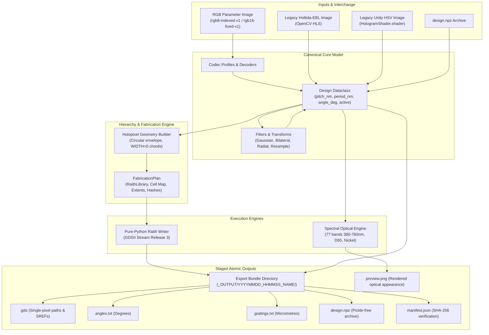

# dot-ebl-preview

## Web application and deployment

[Open Dot EBL Preview](https://mind-black.github.io/dot-ebl-preview/).
The web application processes imported files locally in the browser, with no backend uploads.
Use a current desktop Chromium browser with WebGL2 enabled for the validated optical preview.

From `web`, run `npm ci` and `npm run dev` (http://localhost:3000).
Validate with `npm run check`, `npm test`, and `npm run build`.
Install browser tests with `npx playwright install chromium`, then run `npm run test:browser`.
For production-path testing in PowerShell, set `$env:TEST_PRODUCTION='1'` before the browser command.
This serves `dist` beneath `/dot-ebl-preview/`, including module workers.

Private repositories require an account plan supporting GitHub Pages.
GitHub Settings > Pages must use **GitHub Actions** as the publishing source.
Pull requests validate Python and the production web build. Merging into `main` publishes
`web/dist` after both jobs pass. The Validate and deploy workflow also supports manual
redeployment from `main`. Deployment results and the live URL appear in its `github-pages`
environment; browser reports and failure traces are retained for 14 days.
To roll back, revert the release commit through a PR and merge after checks pass.


## Windows desktop GUI

Run `dist\DotEBLPreview.exe` to open the desktop interface. It loads a PNG/BMP/TIFF design image or a saved `design.npz`, lists every active grating period and angle with cell counts, and shows four panes at once: the original RGB file, the extracted grating period map, the extracted rotation angle map, and live OpenGL diffraction. A saved `.npz` design has no original RGB file, so that pane explains the missing source. The GUI also saves a Raith GDSII file. It offers explicit image interpretations: Holtida legacy HLS, Learning Shaders HLS, Unity HSV, RGB8 indexed, and RGB16 fixed. Choose the interpretation used to create the image; a regular photograph has no defined grating parameters.

The scene starts with the optical model's source and observer positions. Drag the illumination and observation sliders or edit their XYZ positions in millimetres. Select **Direction** to control azimuth, elevation, and distance from the design center instead. Design orientation is a global CCW angle with its own slider. The OpenGL pane updates as controls move. Left drag in that pane orbits the observer; right drag orbits the light; the wheel changes observer distance, and Shift+wheel changes light distance. While controls move, a smaller render target keeps the response quick. After 0.3 seconds without a change, it renders at the design's full resolution. **Refresh preview** captures the full-resolution frame; **Save preview PNG** saves a full-resolution frame. **CPU reference** is available for comparison or machines without OpenGL 3.3 and runs on request. The maps and GDS use the original design angles; changing the preview orientation does not alter fabrication data.

To rebuild the executable from the repository root on Windows:

```powershell
.\.venv\Scripts\python.exe -m pip install -e ".[gui,gui-build]"
.\build_gui.ps1
```

The result is `dist\DotEBLPreview.exe`. For a development launch, use `.\.venv\Scripts\python.exe gui_entry.py` or the `dot-ebl-gui` console entry point after installation. The executable includes Python and the GUI dependencies; it does not need a separate Python installation on the destination Windows machine.

Combined hologram optical diffraction preview and Raith electron-beam lithography (EBL) layout generator.

`dot-ebl-preview` provides a single authoritative physical design representation shared across numeric RGB parameter interchange, a spectral optical preview, image processing/filtering, and pure-Python Raith GDSII layout serialization.

---

## Table of Contents

- [Overview & Architecture](#overview--architecture)
- [Coordinate System & Physical Quantization](#coordinate-system--physical-quantization)
- [RGB Parameter Encoding Contracts](#rgb-parameter-encoding-contracts)
  - [Profile `rgb8-indexed-v1`](#profile-rgb8-indexed-v1)
  - [Profile `rgb16-fixed-v1`](#profile-rgb16-fixed-v1)
  - [Encoding Policies & Error Metrics](#encoding-policies--error-metrics)
- [Command Line Interface (CLI)](#command-line-interface-cli)
  - [CLI Subcommands](#cli-subcommands)
  - [CLI Usage Examples](#cli-usage-examples)
- [Python API Reference](#python-api-reference)
  - [Core Workflows](#core-workflows)
  - [Data Model & Layout Plan](#data-model--layout-plan)
  - [Filters, Operations & Resampling](#filters-operations--resampling)
  - [Legacy Importers](#legacy-importers)
  - [Pure-Python Raith GDSII Writer](#pure-python-raith-gdsii-writer)
  - [Spectral Optical Preview Engine](#spectral-optical-preview-engine)
  - [Python Workflow Example](#python-workflow-example)
- [Export Bundle Specification](#export-bundle-specification)
- [Deferred Features & Roadmap TODOs](#deferred-features--roadmap-todos)
  - [Raith Hardware Primitives](#1-raith-hardware-primitives-curves-text-fbms-aref-csf)
  - [Interactive OpenGL 3.3 Viewer](#2-interactive-opengl-33-viewer)
  - [Calibrated Optical Scattering & RCWA](#3-calibrated-optical-scattering--rcwa)
  - [Position Lists](#4-position-lists-pls)
- [Reference Documents](#reference-documents)

---

## Overview & Architecture

Historically, dot-matrix hologram design tools suffered from impedance mismatches between color models (OpenCV HLS vs. Unity HSV), lossy intermediate RGB conversions, area-dose polygon assumptions, and heavy external layout dependencies (`gdsfactory`/`gdstk`).

`dot-ebl-preview` resolves these issues through four core architectural pillars:

1. **Canonical Physical Design**: The [`Design`](file:///c:/Users/minjuo/Dev/dot-ebl-preview/src/dot_ebl_preview/core/model.py) dataclass stores uncorrupted physical parameters: integer nanometre periods and lattice pitch, 64-bit floating-point rotation angles, explicit boolean activity masks, and provenance tracking. RGB images are treated strictly as an external interchange format.
2. **Raith Single-Pixel Exposure Lines**: Emits zero-width paths (`PATH` records with `WIDTH=0 nm`) inside circular-aperture holopixel cells, replacing legacy filled rectangular polygons. Grating lines are referenced hierarchically via rotated and translated Structure References (`SREF`).
3. **Pure-Python Layout Serializer**: A zero-dependency binary serializer matching the University of Alberta nanoFAB `Raith_GDSII` toolbox specification, producing big-endian GDSII Stream Format release 3 directly.
4. **Float64 Spectral Reference Optics**: CPU geometric diffraction evaluation over 77 wavelength bands (380 nm to 760 nm in 5 nm increments) under standard illuminant D65, CIE 1931 $2^\circ$ color matching, bulk nickel reflectance, and guarded sRGB gamut mapping. Diffraction efficiencies are uncalibrated; this is a qualitative preview.



---

## Coordinate System & Physical Quantization

- **Lattice Pitch & Geometry Units**: All physical distances, grating periods, and vertex coordinates are strictly expressed in integer nanometres (`int` / `np.uint32` / `np.int64`).
- **Lattice Extents & Centers**: For an array of shape $H \times W$ with cell pitch $P$:
  - Cell index $(r, c)$ where row $r \in [0, H-1]$ increases downward (+Y in image space) and column $c \in [0, W-1]$ increases rightward (+X in image space).
  - Fabrication cell center coordinates:
    $$\begin{aligned}
    x_{\text{center}} &= (c + 0.5) \cdot P \\
    y_{\text{center}} &= -(r + 0.5) \cdot P
    \end{aligned}$$
  - Centered preview offset: $(-W \cdot P / 2, +H \cdot P / 2)$.
- **Rounding Half-Away-From-Zero**: To ensure deterministic parity with MATLAB and C99 runtime implementations, all quantization operations use half-away-from-zero rounding:
  $$\text{round}(x) = \begin{cases} \lfloor x + 0.5 \rfloor & \text{if } x \ge 0 \\ \lceil x - 0.5 \rceil & \text{if } x < 0 \end{cases}$$
- **Grating Orientation & Asymmetry**:
  - Grating orientation angles $\theta$ are signed float64 degrees, measured counterclockwise (CCW) from the $+X$ axis.
  - An unrotated grating ($\theta = 0^\circ$) runs along $+X$ with grating vector (normal) along $+Y$.
  - Rotating a cell CCW about $+Z$ gives the reciprocal grating direction $(-\sin\theta, \cos\theta)$, matching its GDSII SREF rotation.
  - Angles are **not** normalized modulo $180^\circ$. Because circular aperture stripe chords $y_k = -P/2 + \Lambda/2 + k\Lambda$ are anchored by physical phase, a $180^\circ$ rotation reverses stripe positions when $P/\Lambda$ is not integral. The full signed branch is preserved in the design and layout reference transforms.

---

## RGB Parameter Encoding Contracts

Numeric parameter images store grating periods, angles, and activity across the R, G, and B channels. Image color-management transforms, sRGB transfer curves, and lossy compression (such as JPEG) are strictly prohibited.

### Profile `rgb8-indexed-v1`

Used for lossless interchange of discrete palettes:

| Channel | Data Type | Meaning | Default Lookup Table / Rule |
| :--- | :--- | :--- | :--- |
| **R** | `uint8` | Period Table Index | $\Lambda = 900 + 10 \cdot R \text{ nm}$ for $R \in [0, 30]$ ($900\text{--}1200\text{ nm}$) |
| **G** | `uint8` | Angle Table Index | $\theta = G - 90.0^\circ$ for $G \in [0, 180]$ ($-90.0^\circ\text{ to }+90.0^\circ$) |
| **B** | `uint8` | Activity Flag | `255` = Active cell (grating present), `0` = Inactive cell |

> [!WARNING]
> Any B channel value other than `0` or `255` is rejected as an illegal reserved code. Alpha channels must not be used to encode activity.

### Profile `rgb16-fixed-v1`

Used for direct physical interchange on a 1 nm period and $0.01^\circ$ angle lattice:

| Channel | Data Type | Meaning | Encoding / Decoding Formula | Physical Range |
| :--- | :--- | :--- | :--- | :--- |
| **R** | `uint16` | Grating Period ($\text{nm}$) | $\text{Code} = \Lambda_{\text{nm}}$ | $100\text{--}65,535\text{ nm}$ |
| **G** | `uint16` | Grating Angle ($0.01^\circ$) | $\text{Code} = \text{round}(\theta \cdot 100) + 32768$<br/>$\theta = (\text{Code} - 32768) / 100.0$ | $-327.68^\circ\text{ to }+327.67^\circ$ |
| **B** | `uint16` | Activity Flag | `65535` = Active, `0` = Inactive | Exact binary flag |

### Encoding Policies & Error Metrics

When exporting an authoritative [`Design`](file:///c:/Users/minjuo/Dev/dot-ebl-preview/src/dot_ebl_preview/core/model.py) to an RGB parameter image:
- **`policy="reject"` (Default)**: Raises `ValueError` if any period or angle cannot be represented exactly in the target profile.
- **`policy="quantize"`**: Snaps values to the nearest entry (by absolute physical distance). Ties in `rgb8-indexed-v1` are broken deterministically by selecting the lowest index.
- **`allow_clip=False` (Default)**: Rejects values exceeding table minima/maxima rather than silently clamping.
- **Verification**: All encoding operations automatically decode the generated image and assert exact activity mask equivalence, producing an [`EncodingReport`](file:///c:/Users/minjuo/Dev/dot-ebl-preview/src/dot_ebl_preview/core/encoding.py) with:
  - `max_period_error_nm` and `rms_period_error_nm`
  - `max_angle_error_deg` and `rms_angle_error_deg`
  - `unrepresentable_count` and `clipped_count`

> [!TIP]
> **Reference Benchmark Asset**: `_INPUT/sekmes_pinigelis_01_RGB.png` ($1075 \times 1075$ uint16 PNG) provides an authoritative reference implementation of `rgb16-fixed-v1`. It encodes the full 702,425-cell "Sėkmės Pinigėlis" design with $0.0\text{ nm}$ period error and $\le 0.005^\circ$ angle error, maintaining $99.62\%$ optical diffraction parity with the historical HSV calculation.

---

## Command Line Interface (CLI)

The CLI tool is available via `dot-ebl` (or `python -m dot_ebl_preview.cli`).

### CLI Subcommands

#### 1. `inspect`
Inspect physical attributes, cell counts, unique period/angle palettes, bounding box, and content hashes from a `.npz` archive or RGB parameter image.
```bash
dot-ebl inspect <input_path> [--profile {rgb8-indexed-v1,rgb16-fixed-v1}] [--pitch-um FLOAT]
```

#### 2. `import-legacy`
Convert legacy Holtida-EBL or Unity HSV images into an authoritative `design.npz` archive.
```bash
dot-ebl import-legacy <input_path> -o <output_npz> \
    [--preset {holtida-ebl,learning-shaders,unity-hsv}] \
    [--mode {corrected,legacy-exact}] \
    [--pitch-um FLOAT] [--downscale INT] \
    [--filter {none,gaussian,bilateral}]
```

#### 3. `export`
Generate and atomically publish a complete Raith EBL layout bundle.
```bash
dot-ebl export <input_path> [-o <output_dir>] [--name <layout_name>] \
    [--profile {rgb8-indexed-v1,rgb16-fixed-v1}] [--pitch-um FLOAT]
```

#### 4. `preview`
Render an optical diffraction appearance preview to a PNG image using the CPU reference engine.
```bash
dot-ebl preview <input_path> -o <output_png> \
    [--preset {corrected,glsl-legacy,unity-hsv}] [--pitch-um FLOAT]
```

### CLI Usage Examples

```bash
# 1. Inspect an existing design archive
dot-ebl inspect _OUTPUT/20260920_134704_SAMPLE_HOLO/design.npz

# 2. Import a legacy bitmap with Holtida-EBL settings and bilateral angle smoothing
dot-ebl import-legacy sample.bmp -o sample_design.npz --preset holtida-ebl --filter bilateral

# 3. Export an EBL fabrication bundle to _OUTPUT
dot-ebl export sample_design.npz --name HOLO_CHIP -o ./_OUTPUT

# 4. Render an optical diffraction preview
dot-ebl preview sample_design.npz -o preview.png --preset corrected
```

---

## Python API Reference

### Core Workflows

The top-level package [`dot_ebl_preview.api`](file:///c:/Users/minjuo/Dev/dot-ebl-preview/src/dot_ebl_preview/api.py) exposes the primary functional interface:

- [`build_design(image_path, encoding_profile='rgb8-indexed-v1', pitch_nm=20000, downscale_factor=1) -> Design`](file:///c:/Users/minjuo/Dev/dot-ebl-preview/src/dot_ebl_preview/api.py#L23-L71)
  Builds a validated [`Design`](file:///c:/Users/minjuo/Dev/dot-ebl-preview/src/dot_ebl_preview/core/model.py#L24-L143) from an RGB parameter image.
- [`build_layout(design, top_name='HOLOGRAM') -> FabricationPlan`](file:///c:/Users/minjuo/Dev/dot-ebl-preview/src/dot_ebl_preview/api.py#L74-L93)
  Derives a frozen [`FabricationPlan`](file:///c:/Users/minjuo/Dev/dot-ebl-preview/src/dot_ebl_preview/layout/plan.py#L17-L30) with deduplicated holopixel cells and SREF references.
- [`export_bundle(design, output_dir, layout_name='HOLOGRAM') -> Path`](file:///c:/Users/minjuo/Dev/dot-ebl-preview/src/dot_ebl_preview/api.py#L96-L129)
  Stages and atomically publishes a complete fabrication bundle with SHA-256 manifest.
- [`inspect_design(design) -> Dict[str, Any]`](file:///c:/Users/minjuo/Dev/dot-ebl-preview/src/dot_ebl_preview/api.py#L132-L178)
  Calculates design summary statistics, cell activity, physical extents, and SHA-256 hashes.
- [`dot_matrix_hologram(...) -> Optional[FabricationPlan]`](file:///c:/Users/minjuo/Dev/dot-ebl-preview/src/dot_ebl_preview/api.py#L185-L238)
  Drop-in backwards compatibility wrapper matching the legacy Holtida-EBL calling convention.

### Data Model & Layout Plan

- [`Design`](file:///c:/Users/minjuo/Dev/dot-ebl-preview/src/dot_ebl_preview/core/model.py#L24-L143):
  The authoritative immutable design representation. Contains `shape` $(H, W)$, `pitch_nm`, `period_nm`, `angle_deg`, `active`, `layer` (0..63), `dose` factor, `region_masks`, `appearance_rgb`, and `fallback_intensity`.
- [`FabricationPlan`](file:///c:/Users/minjuo/Dev/dot-ebl-preview/src/dot_ebl_preview/layout/plan.py#L17-L30):
  The derived fabrication plan containing the compiled [`RaithLibrary`](file:///c:/Users/minjuo/Dev/dot-ebl-preview/src/dot_ebl_preview/raith/library.py), cell structure mapping, stripe count metrics, bounding box [`Extents`](file:///c:/Users/minjuo/Dev/dot-ebl-preview/src/dot_ebl_preview/core/grid.py#L14-L28), and plan hash.
- [`Extents`](file:///c:/Users/minjuo/Dev/dot-ebl-preview/src/dot_ebl_preview/core/grid.py#L14-L28):
  Physical lattice bounding box in nanometres (`x_min_nm`, `x_max_nm`, `y_min_nm`, `y_max_nm`).

### Filters, Operations & Resampling

- [`apply_gaussian_filter(design, sigma=1.0, mode='axial', radius=None) -> Design`](file:///c:/Users/minjuo/Dev/dot-ebl-preview/src/dot_ebl_preview/core/filters.py#L39-L130):
  Valid-only masked Gaussian smoothing. In `'axial'` mode, represents angles as double-angle unit vectors $(\sin 2\theta, \cos 2\theta)$ to eliminate $180^\circ$ boundary discontinuities, lifting the result to the nearest directed branch.
- [`apply_bilateral_filter(design, diameter=3, sigma_color=10.0, sigma_space=100.0, mode='scalar') -> Design`](file:///c:/Users/minjuo/Dev/dot-ebl-preview/src/dot_ebl_preview/core/filters.py#L132-L209):
  Edge-preserving smoothing matching Holtida-EBL parameters.
- [`apply_radial_gradient(design, mask=None, base_angle_deg=-15.0, span_angle_deg=40.0, ...) -> Design`](file:///c:/Users/minjuo/Dev/dot-ebl-preview/src/dot_ebl_preview/core/operations.py#L12-L84):
  Applies radial angle gradients across designated mask regions (e.g. `hue_162`).
- [`downscale_design(design, factor: int) -> Design`](file:///c:/Users/minjuo/Dev/dot-ebl-preview/src/dot_ebl_preview/core/resample.py#L12-L73):
  Nearest-neighbor integer grid downsampling, preserving exact discrete table entries and masks.

### Legacy Importers

- [`import_legacy_hls(image_path, preset='holtida-ebl', mode='corrected', pitch_nm=None, apply_radial=True) -> Design`](file:///c:/Users/minjuo/Dev/dot-ebl-preview/src/dot_ebl_preview/io/legacy_hls.py#L71-L161):
  Decodes historical images through the OpenCV HLS pipeline. `'corrected'` mode fixes historical white-masking and sentinel defects; `'legacy-exact'` mode reproduces historical behavior for audit comparisons.
- [`import_legacy_unity_hsv(image_path, min_angle_deg=-10.0, max_angle_deg=10.0, pitch_nm=60000) -> Design`](file:///c:/Users/minjuo/Dev/dot-ebl-preview/src/dot_ebl_preview/io/legacy_unity.py#L69-L117):
  Port of the `HologramShader.shader` HSV mapping and calibrated 8-period laser palette.

### Pure-Python Raith GDSII Writer

Contained in [`dot_ebl_preview.raith`](file:///c:/Users/minjuo/Dev/dot-ebl-preview/src/dot_ebl_preview/raith):
- [`PathElement(layer, vertices_nm, width_nm=0, df=1.0)`](file:///c:/Users/minjuo/Dev/dot-ebl-preview/src/dot_ebl_preview/raith/elements.py#L26-L55):
  Zero-width single-pixel exposure line path. Encodes dose factor `df` into GDS `DATATYPE` via standard Raith mapping (`1000 * DF` up to 30, $30000 + 2(DF-30)$ above 30).
- [`SrefElement(name, origin_nm, angle_deg=0.0, mag=1.0, reflect=False)`](file:///c:/Users/minjuo/Dev/dot-ebl-preview/src/dot_ebl_preview/raith/elements.py#L58-L85):
  Hierarchical structure placement with rotation, translation, and optional reflection.
- [`write_gds_stream(lib, stream)`](file:///c:/Users/minjuo/Dev/dot-ebl-preview/src/dot_ebl_preview/raith/writer.py#L32-L92):
  Streams binary big-endian GDSII records directly into any writable file-like buffer.

### Spectral Optical Preview Engine

Contained in [`dot_ebl_preview.optics`](file:///c:/Users/minjuo/Dev/dot-ebl-preview/src/dot_ebl_preview/optics):
- [`simulate_cell_optical_color(period_nm, angle_deg, world_pos, params) -> Tuple[float, float, float]`](file:///c:/Users/minjuo/Dev/dot-ebl-preview/src/dot_ebl_preview/optics/engine.py#L88-L246):
  Evaluates diffraction geometry and sRGB color for an individual cell under directional light/camera rays.
- [`render_optical_preview(design, params=None) -> NDArray[np.float32]`](file:///c:/Users/minjuo/Dev/dot-ebl-preview/src/dot_ebl_preview/optics/engine.py#L249-L295):
  Renders a full 2D float32 sRGB optical image.
- [`render_preview_to_file(design, output_path, preset='corrected') -> Path`](file:///c:/Users/minjuo/Dev/dot-ebl-preview/src/dot_ebl_preview/preview/renderer.py#L14-L33):
  Headless PNG rendering entry point.

The CPU preview uses a Gaussian approximation for diffraction from each finite circular holopixel and for collection by the camera aperture. The holopixel diameter comes from `Design.pitch_nm` (20 µm for direct single-cell calls by default). `OpticalSimParams.aperture_radius_factor` is the camera aperture radius in millimetres. The collected fraction approaches inverse-square distance falloff when the aperture is small relative to the diffracted spot; no separate distance multiplier is applied. Incoming and outgoing ray cosines attenuate the result. These approximations do not predict measured diffraction efficiency or polarization.

### Python Workflow Example

```python
from pathlib import Path
from dot_ebl_preview.api import build_design, build_layout, export_bundle, inspect_design
from dot_ebl_preview.core.filters import apply_bilateral_filter
from dot_ebl_preview.preview.renderer import render_preview_to_file

# 1. Build authoritative design from 8-bit indexed RGB parameter image
design = build_design("my_hologram.png", encoding_profile="rgb8-indexed-v1", pitch_nm=20000)

# 2. Apply bilateral angle smoothing to active cells
design_smoothed = apply_bilateral_filter(design, diameter=3, sigma_color=10.0, sigma_space=100.0)

# 3. Inspect design statistics
info = inspect_design(design_smoothed)
print(f"Active Cells: {info['active_cells']} ({info['active_percentage']:.1f}%)")
print(f"Unique Periods: {info['unique_periods_um']} µm")

# 4. Render optical appearance preview
render_preview_to_file(design_smoothed, "preview.png", preset="corrected")

# 5. Export fabrication bundle (GDS, texts, npz, manifest)
bundle_dir = export_bundle(design_smoothed, output_dir="./_OUTPUT", layout_name="MY_HOLO")
print(f"Exported bundle to {bundle_dir}")
```

---

## Export Bundle Specification

Calling `export_bundle()` generates an atomically published directory under `<output_dir>/<YYYYMMDD_HHMMSS>_<layout_name>/`:

| Filename | Format | Description |
| :--- | :--- | :--- |
| `{layout_name}.gds` | Binary GDSII Stream v3 | Pure-Python GDSII layout containing zero-width single-pixel lines and SREFs. |
| `angles.txt` | ASCII Matrix (`%.6f`) | 2D array of grating angles in degrees. Inactive cells marked with `-1000.000000`. |
| `gratings.txt` | ASCII Matrix (`%.6f`) | 2D array of grating periods in micrometres. Inactive cells marked with `0.000000`. |
| `design.npz` | NumPy Zip (`allow_pickle=False`) | Canonical design arrays (`period_nm`, `angle_deg`, `active`, masks, metadata). |
| `manifest.json` | JSON | Machine-readable manifest containing SHA-256 hashes, stripe counts, and timestamps. |

The bundle is fully assembled in a staging directory (`.tmp_*`) and verified before renaming, preventing partial or corrupt outputs.

---

## Deferred Features & Roadmap TODOs

According to [DEVELOPMENT_PLAN.md](docs/DEVELOPMENT_PLAN.md) and [RAITH_PORT.md](docs/RAITH_PORT.md), the following advanced capabilities are deliberately deferred past the initial single-pixel line MVP. Their technical scopes, upstream entry points, and acceptance gates are documented below:

### 1. Raith Hardware Primitives (Curves, Text, FBMS, AREF, CSF)

| Feature | Upstream Entry Point | Scope & Implementation Requirements | Acceptance Gate |
| :--- | :--- | :--- | :--- |
| **Curves** (`arc`, `circle`, `ellipse`) | `Raith_element.m:arc`, `:circle`, `:ellipse`; `Raith_library.m:writerec` | Raith native record type 86 (curved elements), angular start/span encoding, radius bounds. Fallback polygonal tessellation for standard GDS viewers. | Verified curved record emission; tessellation error $\le 1\text{ nm}$. |
| **Text** (`rendertext`) | `Raith_element.m:rendertext` | Polygonized vector glyphs using embedded character font tables. Alignment, kerning, rotation, and simply-connected boundary closure without emitting non-standard GDS `TEXT`. | Visual inspection and closure checks across full ASCII printable set. |
| **FBMS** (`fbmspath`, `fbmscircle`) | `Raith_element.m:fbmspath`, `:fbmscircle`; `Raith_library.m` record 88 | Fixed Beam Moving Stage continuous exposure. Encodes stage movement speed, curvature flags, and line-dose conversion for stitch-free extended waveguides. | Hardware qualification on an FBMS-equipped Raith lithography system. |
| **AREF** (2D Array Reference) | `Raith_element.m:481`; `Raith_library.m:writeelement` | GDS record type 11 (`AREF`). Emits `COLROW` and inter-element spacing vectors to compress regular unrotated/unfiltered cell grids. | Disambiguate Raith vs standard GDS reference transform order; file size reduction validation. |
| **CSF** (Native File Format) | `Raith_library.m:writecsf` | Native Raith Compound Structure File binary container format (`.csf`). | Physical NanoSuite software import test verifying layer mapping, line mode, and dose. |
| **Polygons & Finite Width** | `Raith_element.m:221`, `:305` | Polygons with area-dose assignment; paths with width $>0\text{ nm}$ and $>2$ vertices. | Excluded from current line MVP; required only if area exposure is restored. |

> [!NOTE]
> Stub element classes for deferred primitives are registered in [`dot_ebl_preview.raith.elements`](file:///c:/Users/minjuo/Dev/dot-ebl-preview/src/dot_ebl_preview/raith/elements.py) and enforce explicit exceptions via [`require_element_capability()`](file:///c:/Users/minjuo/Dev/dot-ebl-preview/src/dot_ebl_preview/raith/capabilities.py#L52-L61).

### 2. OpenGL preview and interactive viewer

The desktop GUI now defaults to a persistent OpenGL 3.3 renderer that evaluates the corrected 77-band spectrum on the GPU. It uses the same design arrays, light and observer positions, and orientation controls as the CPU reference. The renderer runs in a hidden GLFW context and sends frames to the GUI's fourth pane. It uses a reduced render target during interaction and a full-resolution render when the scene settles. The `dot-ebl preview` CLI and bundle exports continue to use the CPU reference. More advanced geometry inspection is planned for Phase 3:

- **Instanced GPU Architecture**: Instance VBOs (16–24 bytes/cell) storing grating period, angle, and 3D world offsets.
- **Coordinated Dual View**:
  - *Optical View*: GLSL fragment shader instancing 77 spectral wavelengths across corner-interpolated quads.
  - *Geometry View*: Real-time rendering of Raith single-pixel chord centerlines with screen-space stroke width, holopixel circular envelopes, and orientation vectors.
- **Large-Array Performance ($>2.25\times 10^6$ cells)**:
  - Viewport frustum culling and level-of-detail (LOD) downscaling.
  - Target interactive latency $\le 33\text{ ms}$ (30 FPS) with VRAM footprint $<256\text{ MiB}$.
- **Dynamic Interaction**: Mouse pan and additional geometry tools beyond the current observer/light orbit and distance controls.

### 3. Calibrated Optical Scattering & RCWA

- **Diffraction Efficiency**: The preview uses fixed, uncalibrated order weights ($m = \pm 1$ at $1.0$, $m = \pm 2$ at $1/15$). The smooth finite-cell aperture is a Gaussian approximation, not an electromagnetic efficiency model. A useful RCWA/FDTD lookup table requires measured groove width/depth/profile and wavelength-dependent material constants; no such calibration data is included. Polarization contrast and resonance anomalies therefore remain unmodeled.
- **BRDF & Spatial Illumination**: Support for extended area light sources and substrate diffuse scattering (BRDF).

### 4. Position Lists (`.pls`)

- Port of `Raith_positionlist.m` for automated multi-field stage navigation:
  - Working Area (WA) and Writefield (WF) coordinate alignment.
  - Stage metric conversions (millimetres for stage movements vs micrometres/nanometres for writefields).
  - Chip matrix replication and origin lists.

---

## Reference Documents

- [Development Plan](docs/DEVELOPMENT_PLAN.md): Detailed architectural requirements, mathematical decisions, and phase roadmap.
- [Raith Translation Scope](docs/RAITH_PORT.md): Translation audit of `Raith_GDSII` MATLAB classes to pure Python.
- [Source Audit & Feature Coverage](docs/SOURCE_AUDIT.md): Inventory of features from historical Holtida-EBL, learning-shaders, and Unity shader codebases.
- [Critic Review](docs/CRITIC_REVIEW.md) & [Review Responses](docs/REVIEW_RESPONSE.md): Independent evaluation and resolution log.

## Web fabrication export

Open **Exports & Data Artifacts / EBL Lithography Fabrication** to select layer, dose, structure name, and optional full-grid centering. **Export EBL Layout (.gds)** validates a design snapshot before generation. Generate GDS alone or a ZIP containing GDS, angles.txt, gratings.txt, design.npz, and a manifest with SHA-256 checksums. Closing the dialog cancels its worker.

Image imports default to RGBA continuous, treating RGB sources as opaque. Image parsing, filtering, and statistics run in a worker. NPZ imports retain fabrication settings and artifact metadata. Stored paths and placed exposures are shown separately. Physical instrument qualification remains separate from software validation.

From `web`, run `npm run check`, `npm test`, `npm run test:browser`, and `npm run build`. The Chromium 1075 by 1075 filtered-cell benchmark measured 1.73 seconds decoding and 0.79 seconds validation/export, with 69.3 MB GDS output. These are development-machine observations rather than guarantees.

The published `deployment.json` records the Git commit included in the Pages build.
