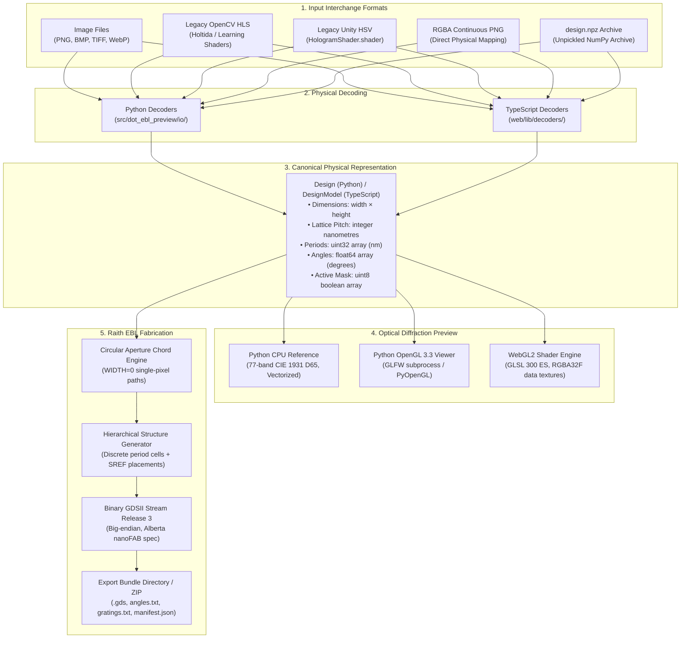

# 01 — System Overview & Architecture

## Executive Summary

`dot-ebl-preview` is a unified dot-matrix hologram design, optical diffraction preview, and electron-beam lithography (EBL) fabrication system. It solves historical impedance mismatches between color models (OpenCV HLS vs. Unity HSV), lossy intermediate RGB representations, area-dose polygon assumptions, and external layout dependencies by maintaining a **single canonical physical design representation**.

The project comprises two deployment targets:
1. **Interactive Web Application (`web/`)**: A client-side, zero-backend WebGL2 single-page application built with TypeScript, Vite, WebGL2 GLSL ES 3.00, Web Workers, and Playwright. Hosted via GitHub Pages.
2. **Desktop Python Platform (`src/dot_ebl_preview/`)**: A Python 3.10+ package with a Tkinter multi-pane GUI (`DotEBLPreview.exe` via PyInstaller), CLI tool (`dot-ebl`), PyOpenGL/GLFW real-time viewer, and pure-Python Raith GDSII binary serializer.

---

## Directory Organization

```
dot-ebl-preview/
├── src/dot_ebl_preview/           # Python core package
│   ├── core/                      # Data model, quantization, filters, and encoding
│   │   ├── model.py               # Canonical Design dataclass
│   │   ├── encoding.py            # Codec profiles (RGB8, RGB16, RGBA continuous)
│   │   ├── filters.py             # Gaussian, bilateral, radial transforms
│   │   └── resample.py            # Downscaling and cell aggregation
│   ├── io/                        # Image decoders and NPZ serialization
│   │   ├── images.py              # PIL/OpenCV loaders and color conversion
│   │   └── legacy_hls.py          # Holtida & Learning Shaders HLS decoders
│   ├── optics/                    # Physical diffraction optics engine
│   │   ├── engine.py              # 77-band CIE 1931 D65 spectral CPU optics
│   │   ├── presets.py             # Optical configuration presets
│   │   └── tables.py              # Wavelengths, CIE matching, nickel reflectance
│   ├── preview/                   # Hardware-accelerated OpenGL preview
│   │   ├── gl_renderer.py         # PyOpenGL GLSL ES 3.00 renderer
│   │   └── realtime.py            # GLFW interactive viewport subprocess
│   ├── raith/                     # Pure-Python GDSII layout serializer
│   │   ├── writer.py              # Stream Release 3 binary writer
│   │   ├── geometry.py            # Circular aperture single-pixel chords
│   │   └── bundle.py              # Export bundle packager (ZIP, manifest, hashes)
│   ├── api.py                     # High-level programmatic Python API
│   ├── cli.py                     # CLI commands (import-legacy, preview, export-gds)
│   ├── gui.py                     # Tkinter multi-pane desktop interface
│   └── gui_logic.py               # Shared desktop GUI view-model and state logic
│
├── web/                           # Client-side WebGL2 web platform
│   ├── components/                # Modular UI components
│   │   ├── viewer/                # DualViewport, FlatView, PerspectiveView
│   │   ├── controls/              # SceneControls, DesignControls, ParameterMapCanvas
│   │   ├── export/                # ExportControls, StatsPanel, FabricationModal
│   │   └── welcome/               # WelcomeView landing view
│   ├── lib/                       # Core TypeScript libraries
│   │   ├── decoders/              # RGBA continuous, RGB8, RGB16, HLS, Unity
│   │   ├── optics/                # WebGL2 renderer, GLSL shaders, spectral tables
│   │   ├── raith/                 # TypeScript GDSII writer, chord engine, workers
│   │   ├── store/                 # designStore, sceneStore, Web Workers
│   │   ├── presets/               # Procedural physical test benchmarks
│   │   └── io/                    # PNG and NPZ binary parsers
│   ├── tests/                     # Test suites
│   │   ├── unit/                  # Vitest unit tests (optics, decoders, store)
│   │   ├── browser/               # Playwright browser integration tests
│   │   └── fixtures/              # Parity fixtures and reference test data
│   ├── main.ts                    # Application bootstrapper
│   ├── style.css                  # Dark scientific workbench design system
│   └── vite.config.ts             # Vite bundler configuration
│
├── docs/                          # Architectural and engineering specifications
│   ├── architecture/              # Comprehensive codebase reference documents
│   ├── reference/                 # Reference specifications (Raith_GDSII)
│   └── ...                        # Historical audits and integration plans
│
├── tests/                         # Python pytest test suite
├── tools/                         # Maintenance and fixture generation scripts
├── gui_entry.py                   # PyInstaller desktop GUI entrypoint
├── build_gui.ps1                  # PowerShell Windows build script for GUI
└── pyproject.toml                 # Python project packaging and dependencies
```

---

## End-to-End Architectural Pipeline



---

## Key Invariants

1. **Physical Quantization**:
   - All spatial distances, lattice pitches, and grating periods are strictly integer nanometres (`np.uint32` / `Uint32Array`).
   - Angles are 64-bit IEEE floating-point degrees (`np.float64` / `Float64Array`) bounded in $[-90.0^\circ, +90.0^\circ]$ or normalized to $(0, 180^\circ]$ during export.
   - Half-away-from-zero rounding is used across all conversions to ensure deterministic cross-language parity between Python, JavaScript, MATLAB, and C runtime routines.

2. **Single-Pixel Exposure Geometry**:
   - Hologram cells are circular apertures of diameter equal to the cell pitch ($D = P$).
   - Grating lines are emitted as zero-width paths (`PATH` records with `WIDTH = 0 nm`).
   - Area-dose filled polygons are prohibited.

3. **Qualitative Optical Consistency**:
   - The spectral preview models geometric diffraction across 77 discrete bands ($380\,\text{nm}$ to $760\,\text{nm}$) evaluated with CIE 1931 $2^\circ$ color matching under standard Illuminant D65, bulk nickel reflectance, and guarded sRGB gamut clipping.
   - Diffraction intensities are uncalibrated (relative qualitative visualization).
