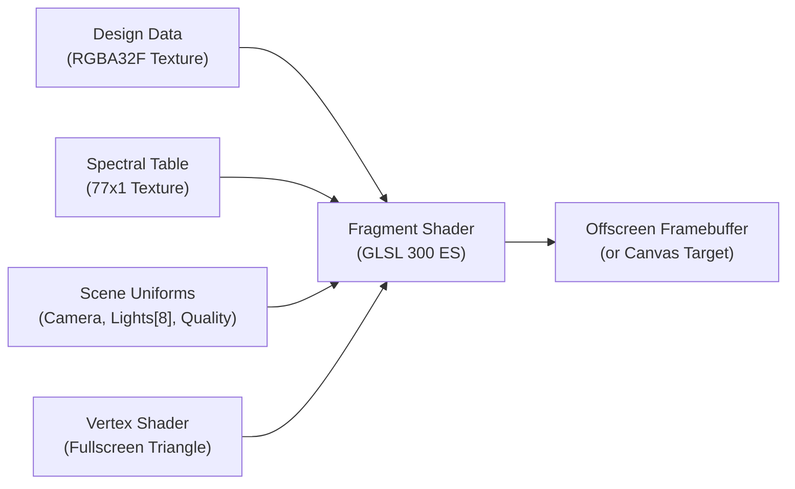

# 03 — Optical Diffraction Physics & Rendering

## Theoretical Foundations

`dot-ebl-preview` implements a physical geometric diffraction model over the visible spectrum. The engine simulates diffraction from planar reflection gratings under multi-source illumination, taking into account spectral power distributions, material reflectance, finite optical apertures, and standard human color perception.

---

## 1. Geometric Diffraction Grating Equation

For a holopixel cell located at physical world position $\mathbf{x}_{\text{world}} = (x, y, 0)$ in the plane $z = 0$:

```
               Observer (Camera)           Light Source
                     \                         /
                      \                       /
                       \                     /
                        v                   v
                     ------------------------------- Hologram Surface (z=0)
                            Grating lines at angle θ
```

1. **Light Vector**:
   For light source $l$ at $\mathbf{p}_{\text{light}, l}$:
   $$\mathbf{v}_{\text{light}} = \mathbf{p}_{\text{light}, l} - \mathbf{x}_{\text{world}}, \quad \hat{\mathbf{k}}_{\text{light}} = \frac{\mathbf{v}_{\text{light}}}{\|\mathbf{v}_{\text{light}}\|}$$
   Incidence cosine: $\cos \theta_{\text{inc}} = \max(0, \hat{k}_{\text{light}, z})$.

2. **Observer (Camera) Vector**:
   For camera position $\mathbf{p}_{\text{cam}}$:
   $$\mathbf{v}_{\text{cam}} = \mathbf{p}_{\text{cam}} - \mathbf{x}_{\text{world}}, \quad \hat{\mathbf{k}}_{\text{cam}} = \frac{\mathbf{v}_{\text{cam}}}{\|\mathbf{v}_{\text{cam}}\|}$$

3. **Grating Vector**:
   For grating orientation angle $\theta_{\text{deg}}$ (rotated counter-clockwise relative to +X axis) and grating period $\Lambda$ (in nm):
   $$\theta = \text{radians}(\theta_{\text{deg}} + \theta_{\text{global\_orientation}})$$
   $$\hat{\mathbf{g}} = \begin{pmatrix} -\sin \theta \\ \cos \theta \end{pmatrix}$$
   Notice that $\hat{\mathbf{g}}$ is perpendicular to the physical grating groove lines.

4. **Diffracted Wavevector (Orders $m = \pm 1$)**:
   For wavelength $\lambda$ (in nm):
   $$\boldsymbol{\alpha}_{xy} = -\hat{\mathbf{k}}_{\text{light}, xy} + m \cdot \frac{\lambda}{\Lambda} \cdot \hat{\mathbf{g}}$$
   Propagating wave check:
   $$\alpha_{12} = \|\boldsymbol{\alpha}_{xy}\|^2$$
   If $\alpha_{12} \le 1.0$, the diffraction wave propagates into the upper half-space ($z > 0$):
   $$\alpha_z = \sqrt{1.0 - \alpha_{12}}, \quad \hat{\boldsymbol{\alpha}} = \begin{pmatrix} \boldsymbol{\alpha}_{xy} \\ \alpha_z \end{pmatrix}$$
   If $\alpha_{12} > 1.0$, the order is evanescent (non-propagating) and contributes zero intensity.

---

## 2. Finite Aperture & Angular Convolutions

Real-world light sources and optical detectors have finite physical dimensions rather than infinitesimal point geometry. This creates angular beam divergence and spot broadening:

1. **Angular Beam Divergence**:
   - Diffraction divergence from cell aperture $P$: $\sigma_{\text{diff}} = \frac{0.5 \lambda}{P}$.
   - Source angular radius: $\rho_{\text{source}} = \frac{r_{\text{source}}}{\|\mathbf{v}_{\text{light}}\|}$.
   - Detector angular radius: $\rho_{\text{det}} = \frac{r_{\text{aperture}}}{\|\mathbf{v}_{\text{cam}}\|}$.

2. **Total Convolved Angular Variance**:
   $$\sigma_{\text{beam}}^2 = \sigma_{\text{diff}}^2 + \frac{1}{4} \rho_{\text{source}}^2$$
   $$\sigma_{\text{tot}}^2 = \sigma_{\text{beam}}^2 + \frac{1}{4} \rho_{\text{det}}^2$$

3. **Angular Weighting Factor**:
   The angle $\vartheta$ between the diffracted ray $\hat{\boldsymbol{\alpha}}$ and the camera ray $\hat{\mathbf{k}}_{\text{cam}}$:
   $$\vartheta = \arccos\left(\text{clamp}(\hat{\boldsymbol{\alpha}} \cdot \hat{\mathbf{k}}_{\text{cam}}, -1.0, 1.0)\right)$$
   Fraction of beam aligned with detector:
   $$\eta = 1.0 - \exp\left(-\frac{1}{2} \frac{\rho_{\text{det}}^2}{\max(10^{-12}, \sigma_{\text{beam}}^2)}\right)$$
   Gaussian angular weight:
   $$W(\vartheta) = \eta \cdot \exp\left(-\frac{1}{2} \frac{\vartheta^2}{\sigma_{\text{tot}}^2}\right)$$

---

## 3. Spectral Integration & Colorimetry

The spectral engine integrates across **77 discrete wavelength bands** from $380\,\text{nm}$ to $760\,\text{nm}$ in $5\,\text{nm}$ steps:

1. **Spectral Distribution**:
   For each band $i$ ($380, 385, \dots, 760\,\text{nm}$):
   - $S(\lambda_i)$: CIE Standard Illuminant D65 relative spectral power.
   - $R(\lambda_i)$: Wavelength-dependent reflectance of bulk nickel substrate.
   - $\bar{x}(\lambda_i), \bar{y}(\lambda_i), \bar{z}(\lambda_i)$: CIE 1931 $2^\circ$ standard observer color matching functions.

2. **Precomputed Spectral Weights**:
   To minimize per-pixel computation, the product:
   $$\mathbf{C}(\lambda_i) = S(\lambda_i) \cdot R(\lambda_i) \cdot \begin{pmatrix} \bar{x}(\lambda_i) \\ \bar{y}(\lambda_i) \\ \bar{z}(\lambda_i) \end{pmatrix}$$
   is precomputed into a $77 \times 1$ RGB/XYZ lookup table (`u_spectrum` in WebGL2, `SPECTRAL_XYZ_TABLE` in Python).

3. **Tristimulus Accumulation**:
   For all active light sources $l \in [0, N_{\text{lights}}-1]$ and orders $m \in \{-1, +1\}$:
   $$\mathbf{XYZ} = \frac{1}{Y_{\text{white}}} \sum_{l} I_l \cdot \cos \theta_{\text{inc}, l} \sum_{i=0}^{76} \mathbf{C}(\lambda_i) \sum_{m=\pm 1} \alpha_{z, m} \cdot W(\vartheta_{l, i, m})$$

---

## 4. Guarded sRGB Gamut Mapping

Monochromatic diffraction grating reflections often produce pure spectral colors outside the standard sRGB gamut triangle. Direct clipping causes severe hue distortion (clamping to white or saturated magenta). The platform uses **guarded chromaticity desaturation toward illuminant white**:

1. **Chromaticity Coordinates**:
   $$x = \frac{X}{X + Y + Z}, \quad y = \frac{Y}{X + Y + Z}$$

2. **Gamut Boundary Intersection**:
   If $(x, y)$ falls outside the sRGB triangle defined by primaries:
   - $\text{Red}: (0.64, 0.33)$
   - $\text{Green}: (0.30, 0.60)$
   - $\text{Blue}: (0.15, 0.06)$
   - $\text{White Point (D65)}: (0.3127, 0.3290)$

   A ray is cast from $(x, y)$ toward the D65 white point, computing the intersection with the closest gamut triangle segment. The chromaticity is clamped to $99\%$ of this boundary distance, preserving dominant wavelength while reducing saturation.

3. **Linear to sRGB Companding**:
   $$\mathbf{RGB}_{\text{linear}} = \mathbf{M}_{\text{XYZ}\to\text{RGB}} \cdot \mathbf{XYZ}$$
   $$C_{\text{srgb}} = \begin{cases} 12.92 \cdot C & \text{if } C \le 0.0031308 \\ 1.055 \cdot C^{1/2.4} - 0.055 & \text{if } C > 0.0031308 \end{cases}$$

---

## 5. WebGL2 GPU Pipeline

File: `web/lib/optics/glRenderer.ts`, `web/lib/optics/shaders.ts`



- **`u_design` Texture**: An `RGBA32F` floating-point 2D texture storing:
  - Channel R: Grating period $\Lambda$ in nanometres (`period_nm`).
  - Channel G: Grating orientation $\theta$ in degrees (`angle_deg`).
  - Channel B: Active flag ($1.0$ if active, $0.0$ if inactive).
  - Channel A: Fallback grayscale intensity.
- **`u_spectrum` Texture**: A $77 \times 1$ floating-point texture storing precomputed spectral response triples.
- **Oversized Single-Triangle Geometry**: Renders a single screen-covering triangle with vertex coordinates `vec2(-1,-1)`, `vec2(3,-1)`, `vec2(-1,3)` without vertex buffer bandwidth overhead.
