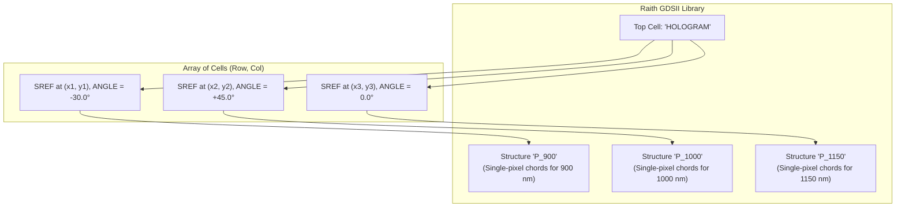

# 04 — Raith EBL Fabrication Engine & GDSII Serializer

## Physical Fabrication Principles

Commercial electron-beam lithography (EBL) systems (e.g., Raith Voyager, Raith EBPG) manufacture dot-matrix holograms using **single-pixel exposure lines**. Rather than filling grating lines as polygonal area-dose boxes, the electron beam executes continuous zero-width sweeps (`PATH` records with `WIDTH = 0 nm`) directly along grating chords.

---

## 1. Circular Aperture Holopixel Chords

Each holopixel cell is defined by a circular aperture of diameter equal to the cell pitch ($D = P$, radius $R = P/2$):

```
                       +Y ^
                          |  ..---..
                       .-'         '-.  Chord at x = k * Λ
                      /   |       |   \
                     |    |       |    |
           ----------+----+-------+----+----------> +X
                     |    |       |    |
                      \   |       |   /
                       '-.         .-'
                          ''---''
```

1. **Chord Positions**:
   For a grating period $\Lambda$ (in nm) and cell pitch $P$:
   - The central line passes through the cell center ($x = 0$).
   - Symmetric chords are placed at offsets $x_k = k \cdot \Lambda$ for integers $k \in [-k_{\text{max}}, +k_{\text{max}}]$, where $k_{\text{max}} = \lfloor (R - \epsilon) / \Lambda \rfloor$.

2. **Chord Endpoints**:
   For a chord at transverse offset $x_k$:
   $$y_k = \sqrt{\max\left(0, R^2 - x_k^2\right)}$$
   The line segment extends from $(x_k, -y_k)$ to $(x_k, +y_k)$ in local cell coordinates.

3. **Single-Pixel Path Record**:
   In GDSII, this segment is serialized as a 2-point path:
   - `PATH` element with `PATHTYPE = 0` (square-ended) and `WIDTH = 0 nm`.
   - Coordinates: `XY = [(x_k, -y_k), (x_k, +y_k)]`.

---

## 2. Hierarchical Structure References (`SREF`)

Directly writing tens of thousands of individual lines at rotated coordinates would produce massive, unmanageable GDSII files (hundreds of megabytes). `dot-ebl-preview` implements **hierarchical cell instancing**:



1. **Template Structures (`BGNSTR` / `ENDSTR`)**:
   - For each distinct grating period $\Lambda$ present in the design, a template cell named `P_<period>` (e.g. `P_1000`) is created once.
   - The cell contains only the unrotated vertical chords centered at $(0, 0)$.

2. **Instance References (`SREF`)**:
   - In the top-level structure (named `HOLOGRAM`), each active holopixel $(r, c)$ references its corresponding template structure.
   - The reference specifies:
     - `SNAME`: Structure name (e.g. `P_1000`).
     - `XY`: Cell center coordinates $(x_{\text{center}}, y_{\text{center}})$.
     - `STRANS`: Transformation flags.
     - `ANGLE`: Rotation angle $\theta$ in degrees.

---

## 3. Pure-Python & Web Worker GDSII Binary Writers

The GDSII serializer matches the University of Alberta nanoFAB `Raith_GDSII` toolbox release 3 specification. It produces big-endian GDSII Stream format binary files with zero third-party dependencies (no C extensions or layout compilers required):

### GDSII Record Layout
Every record consists of a 4-byte header followed by variable data:
- `length` (2 bytes, `uint16`, big-endian): Total byte length including the 4-byte header.
- `record_type` (1 byte, `uint8`): Record identification tag.
- `data_type` (1 byte, `uint8`): Data encoding (0 = No Data, 1 = Bit Array, 2 = int16, 3 = int32, 4 = float32, 5 = float64, 6 = ASCII).

| Record | Tag Hex | Data Type | Purpose |
| :--- | :--- | :--- | :--- |
| `HEADER` | `0x0002` | `int16` | GDSII Stream Release 3 format version |
| `BGNLIB` | `0x0102` | `int16[12]` | Library creation and modification timestamps |
| `LIBNAME`| `0x0206` | `ASCII` | Library name string (null-padded to even length) |
| `UNITS`  | `0x0305` | `float64[2]` | User units in metres ($10^{-6}$) and database units in metres ($10^{-9}$) |
| `BGNSTR` | `0x0502` | `int16[12]` | Structure definition begin timestamp |
| `STRNAME`| `0x0606` | `ASCII` | Structure name (e.g. `P_1000`, `HOLOGRAM`) |
| `SREF`   | `0x0A00` | No Data | Structure reference begin |
| `SNAME`  | `0x1206` | `ASCII` | Referenced template structure name |
| `STRANS` | `0x1A01` | `uint16` | Transformation flags (reflection, magnification) |
| `ANGLE`  | `0x1C05` | `float64` | Rotation angle in degrees |
| `XY`     | `0x1003` | `int32[2N]` | Coordinate pairs in database units (integer nanometres) |
| `ENDEL`  | `0x1100` | No Data | Element terminator |
| `ENDSTR` | `0x0700` | No Data | Structure definition end |
| `ENDLIB` | `0x0400` | No Data | Library terminator |

---

## 4. Export Bundle Specification

When exporting fabrication packages (via CLI `dot-ebl export-bundle` or Web UI "Export Fabrication Bundle"), an atomic directory or ZIP archive is generated containing:

```
YYYYMMDD_HHMMSS_<NAME>/
├── layout.gds           # Authoritative hierarchical Raith GDSII stream binary
├── angles.txt           # Rotation angles in degrees for every active cell
├── gratings.txt         # Grating periods in micrometres (µm)
├── design.npz           # Canonical NumPy archive with provenance and pitch
├── preview.png          # High-resolution rendered optical diffraction snapshot
└── manifest.json        # Cryptographic verification manifest
```

### Verification Manifest (`manifest.json`)
```json
{
  "version": "1.0",
  "created_at": "2026-11-04T12:00:00Z",
  "design_hash": "a1b2c3d4...",
  "plan_hash": "e5f6g7h8...",
  "files": {
    "layout.gds": { "size_bytes": 1048576, "sha256": "..." },
    "angles.txt": { "size_bytes": 65536, "sha256": "..." },
    "gratings.txt": { "size_bytes": 65536, "sha256": "..." },
    "design.npz": { "size_bytes": 262144, "sha256": "..." },
    "preview.png": { "size_bytes": 131072, "sha256": "..." }
  }
}
```
All hashes are computed using SHA-256 to ensure complete fabrication traceability between design parameters, layout binary, and optical preview.
