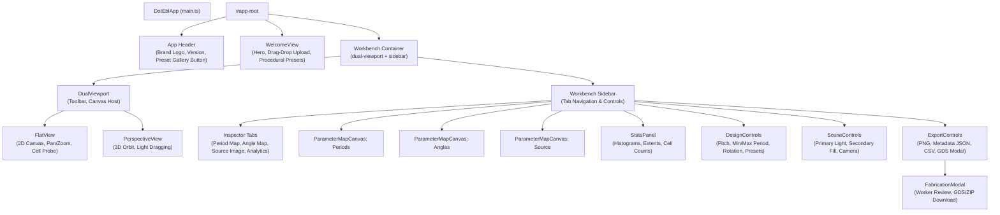

# 05 — Web Application Frontend Architecture

## Architectural Principles

The Web Application (`web/`) is an interactive single-page application (SPA) executing client-side diffraction optics and EBL layout synthesis without server-side computation. It is built in strict TypeScript with standard Web APIs (WebGL2, Canvas 2D, Web Workers, TypedArrays).

---

## Component Tree & DOM Hierarchy



---

## State Stores

State management is decoupled into two reactive singleton stores in `web/lib/store/`:

### 1. `designStore` (`web/lib/store/designStore.ts`)
Tracks the active physical design and coordinates worker-offloaded transforms:
- `currentDesign: DesignModel | null`: The active physical hologram.
- `sourceImage: ImageData | null`: Raw uploaded image pixels (if loaded from image file).
- `sourceRevision: number`: Monotonically increasing revision counter triggering cache invalidation in renderers.
- `designWorker: Worker`: Background Web Worker (`designWorker.ts`) performing heavy parameter filtering and histogram binning without stuttering the UI.

### 2. `sceneStore` (`web/lib/store/sceneStore.ts`)
Tracks illumination, optical observer, and interface interaction state:
- `cameraPos: Point3D`: Physical observer position in millimetres (default: `(0, 0, 300)`).
- `apertureRadiusMm: number`: Observer detector radius (default: $2.0\,\text{mm}$).
- `orientationDeg: number`: Global counter-clockwise rotation applied to all grating angles (default: $0.0^\circ$).
- `quality: QualityLevel`: Spectral band sampling resolution (`'fast'` = 19 bands, `'balanced'` = 39 bands, `'high'` = 77 bands).
- `primaryLight: LightSettings`: Position, physical source globe radius, and intensity.
- `secondaryLightEnabled: boolean`: Toggle for secondary fill illumination.
- `secondaryLight: LightSettings`: Independent fill light source parameters.
- `isInteracting: boolean`: Flag set to `true` during active slider dragging or mouse orbiting; causes renderers to prioritize frame rates by rendering to reduced targets.
- `activeTab: 'periods' | 'angles' | 'source' | 'analytics'`: Active 2D inspector tab.

---

## Viewports & Rendering Lifecycle

### Flat 2D View (`web/components/viewer/FlatView.ts`)
- Utilizes an offscreen WebGL2 renderer (`WebGlDiffractionRenderer`) rendering at design resolution ($W \times H$).
- Blits the offscreen buffer onto a 2D HTML5 canvas supporting:
  - Infinite pan and continuous zoom (wheel and drag).
  - Pixel-exact inspection: clicking or navigating with keyboard arrow keys selects individual holopixels and updates the cell probe readout (`Cell (r, c): Period = ... nm, Angle = ...°`).
  - Boundary framing outline.

### 3D Perspective View (`web/components/viewer/PerspectiveView.ts`)
- Direct WebGL2 rendering with perspective projection:
  - Left-click drag: Orbits the physical camera around the hologram center.
  - Right-click drag: Orbits the primary light source across azimuth and elevation.
  - Wheel / Shift+wheel: Adjusts camera distance and light distance.

### Render Loop & Coalescing
Rendering requests are debounced using `requestAnimationFrame`:
```typescript
public requestRender(): void {
  if (this.rafId !== null) return;
  this.rafId = requestAnimationFrame(() => {
    this.rafId = null;
    this.render();
  });
}
```
When `sceneStore` or `designStore` notifies listeners of parameter updates, `requestRender()` coalesces multiple updates within a single display frame.

---

## Web Workers Architecture

To prevent browser freeze during computationally heavy operations on designs with hundreds of thousands or millions of cells, two dedicated workers are employed:

1. **`designWorker.ts`**:
   - Computes parameter histograms (discrete period counts, orientation distributions).
   - Extracts min/max statistics.
   - Evaluates filter kernels (e.g. smoothing, thresholding).

2. **`fabricationWorker.ts`**:
   - Assembles the complete hierarchical GDSII binary stream.
   - Computes chord intersections and formats SREF instances.
   - Creates the ZIP archive containing `.gds`, `angles.txt`, `gratings.txt`, `design.npz`, and `manifest.json`.
   - Emits progress events allowing the `FabricationModal` to display real-time percentage progress bars.
