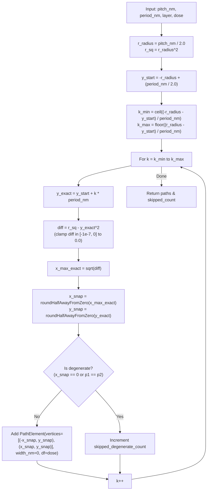
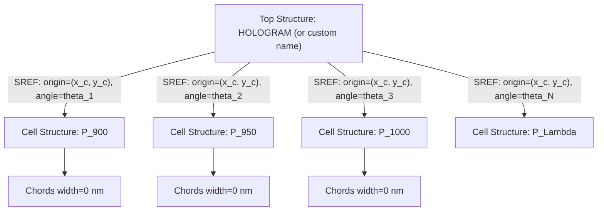
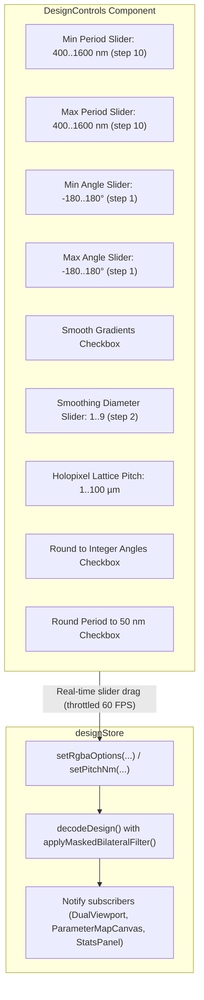
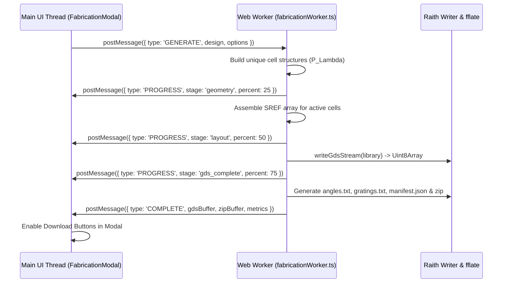
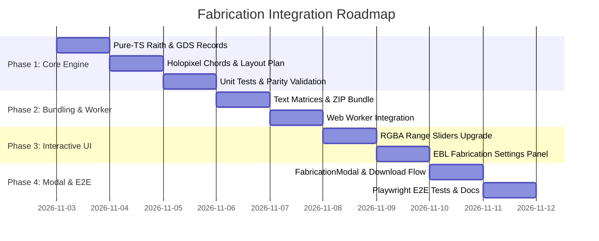

> Implementation update (2026-11-02): the executable web implementation uses a validate-first dialog, workers for editing and export, full dose range 0–17797.5, and full-grid centering. Bundles include design.npz and retain Python manifest fields with a versioned web extension. Stored-path metrics and placement-weighted exposure metrics are separate. Hardware qualification remains separate; timing is measured rather than guaranteed. The original proposal below is retained as design history where it differs from these decisions.


# Web EBL Fabrication Integration — Architectural Specification & Implementation Plan


Reviewed and authored on **2026-11-02** against the canonical Python implementation (`src/dot_ebl_preview/`), existing web platform (`web/`), and user requirements aligned through the `/grill-me` architectural interview.


---


## 1. Executive Summary & Objectives


### 1.1 Goal

Integrate the complete electron-beam lithography (EBL) fabrication layout and export engine from the Python implementation into the client-side Web application (`web/`).


In the finalized workflow:

1. The user uploads a design image (PNG, BMP, JPG, WebP) or imports a `.npz` design archive.

2. The user interactively tinkers with physical parameters in real time using linked range sliders:

   - Grating periodicity bounds ($\Lambda_{\min}\text{--}\Lambda_{\max}$ in nanometres)

   - Rotation angle ranges ($\theta_{\min}\text{--}\theta_{\max}$ in degrees)

   - Bilateral filter smoothing strength (diameter, spatial sigma, color sigmas)

   - Holopixel lattice pitch ($P$ in micrometres / nanometres)

   - Discrete quantization toggles (integer angle rounding, 50 nm period rounding)

3. The user configures fabrication parameters (GDS layer, dose factor, top-cell structure name, coordinate centering).

4. The user clicks **Export EBL GDS** to open a pre-export validation modal displaying physical metrics (active cells, total single-pixel stripes, skipped degenerate chords, bounding extents).

5. The web application generates and downloads:

   - A ready-to-use, software-validated **`.gds`** layout file (big-endian GDSII Stream Release 3) with zero-width single-pixel exposure paths.

   - An optional complete **Fabrication Bundle (`.zip`)** containing `.gds`, `angles.txt`, `gratings.txt`, and `manifest.json` with SHA-256 verification hashes.


### 1.2 Core Architectural Principles

- **100% Client-Side Execution (Zero Backend)**: The layout generation, chord geometry calculations, GDSII binary record streaming, and ZIP bundling execute entirely inside the user's browser.

- **Web Worker Offloading**: Large designs ($>500\text{k}$ holopixels) compile inside a dedicated Web Worker (`fabricationWorker.ts`), maintaining 60 FPS UI responsiveness and live progress reporting.

- **Bit-Level Mathematical Parity**: Strict adherence to the University of Alberta nanoFAB `Raith_GDSII` format and the canonical Python contracts in `src/dot_ebl_preview/`.

- **Single-Pixel Line Exposure Integrity**: Circular-aperture holopixels emit zero-width `PATH` records (`WIDTH = 0 nm`) with dose factors mapped to GDS `DATATYPE` via standard Raith `DFint`.


---


## 2. User Decisions & Design Tree Resolutions


| Dimension | Decision | Rationale & Impact |

| :--- | :--- | :--- |

| **Execution Environment** | **Pure TypeScript in Web Worker** | Eliminates server infrastructure, cloud hosting costs, data privacy concerns, and heavy 30MB+ WebAssembly/Pyodide runtimes. |

| **Export Formats** | **Standalone `.gds` + Full `.zip` Bundle** | Direct 1-click `.gds` download for rapid lithography tool loading; `.zip` bundle matches Python desktop/CLI export. Native `.csf` format is documented as deferred pending physical Raith NanoSuite qualification. |

| **Single-Pixel Exposure** | **Strict Single-Pixel Parity** | Raith zero-width (`WIDTH=0`) chord lines with integer-nanometre endpoints and Raith `DFint` dose mapping. No polygonization or area-dose approximations. |

| **UI Workflow & Sliders** | **RGBA Continuous as Default with Range Sliders** | Any uploaded image defaults to the RGBA continuous profile. Range sliders with linked numeric inputs enable fluid real-time parameter tweaking. |

| **EBL Configuration** | **Collapsible Settings with Defaults** | Exposes GDS Layer (default: 1), Dose Factor (default: 1.0), Top Structure Name (default: `HOLOGRAM`), and Coordinate Centering toggle. |

| **Coordinate Origin** | **Python Parity Default with Centering Option** | Defaults to Python convention: top-left index origin $x = (c + 0.5)P, y = -(r + 0.5)P$. Provides optional toggle to center the bounding box at $(0, 0)$. |

| **Validation & Progress** | **Pre-Export Validation Dialog** | Displays fabrication metrics, geometry checks, and live progress bar with direct download actions. |


---


## 3. Authoritative Technical Contracts & Mathematical Specifications


### 3.1 Holopixel Chord Geometry & Single-Pixel Exposure


The holopixel single-pixel stripe generator in TypeScript must strictly mirror `dot_ebl_preview.layout.holopixel.generate_holopixel_stripes`:





#### Mathematical Formulas

1. **Lattice Pitch & Circle Envelope**:

   $$\begin{aligned}

   R &= \frac{P}{2.0} \\

   y_{\text{start}} &= -R + \frac{\Lambda}{2.0}

   \end{aligned}$$

2. **Index Bounds**:

   $$\begin{aligned}

   k_{\min} &= \left\lceil \frac{-R - y_{\text{start}}}{\Lambda} \right\rceil \\

   k_{\max} &= \left\lfloor \frac{R - y_{\text{start}}}{\Lambda} \right\rfloor

   \end{aligned}$$

3. **Chord Coordinates & Integer Nanometre Snapping**:

   For each integer $k \in [k_{\min}, k_{\max}]$:

   $$\begin{aligned}

   y_{\text{exact}} &= y_{\text{start}} + k \cdot \Lambda \\

   x_{\max} &= \sqrt{\max(0.0, R^2 - y_{\text{exact}}^2)} \\

   x_{\text{snap}} &= \text{roundHalfAwayFromZero}(x_{\max}) \\

   y_{\text{snap}} &= \text{roundHalfAwayFromZero}(y_{\text{exact}})

   \end{aligned}$$

4. **Rounding Half-Away-From-Zero**:

   $$\text{roundHalfAwayFromZero}(x) = \begin{cases} \lfloor x + 0.5 \rfloor & \text{if } x \ge 0 \\ \lceil x - 0.5 \rceil & \text{if } x < 0 \end{cases}$$

5. **Degenerate Chord Elimination**:

   If $x_{\text{snap}} == 0$, the chord length is zero ($p_1 = p_2 = (0, y_{\text{snap}})$). It is omitted and incremented into `skipped_degenerate_stripes`.


---


### 3.2 Raith Structure Hierarchy & SREF Placement


To keep layout file sizes compact and compile within seconds, the layout is organized hierarchically:





1. **Holopixel Structure Deduplication**:

   - For every unique grating period $\Lambda$ active in the design, a cell structure named `P_{period}` (sanitized to $\le 32$ ASCII alphanumeric/underscore characters) is defined once.

   - The cell structure contains the horizontal unrotated zero-width chords centered at $(0, 0)$.

2. **Top-Level SREF Placement**:

   - The top structure (sanitized name, default `HOLOGRAM`) contains a Structure Reference (`SREF`) for every active cell $(r, c)$.

   - **Cell Center Calculation**:

     $$\begin{aligned}

     x_{\text{center}} &= \text{roundHalfAwayFromZero}((c + 0.5) \cdot P) - x_{\text{offset}} \\

     y_{\text{center}} &= \text{roundHalfAwayFromZero}(-(r + 0.5) \cdot P) - y_{\text{offset}}

     \end{aligned}$$

     - In default mode (Python parity): $x_{\text{offset}} = 0$, $y_{\text{offset}} = 0$.

     - In centered mode: $x_{\text{offset}} = \text{roundHalfAwayFromZero}(W \cdot P / 2.0)$, $y_{\text{offset}} = \text{roundHalfAwayFromZero}(-H \cdot P / 2.0)$.

   - **Rotation**: Grating orientation angle $\theta$ (float64 degrees CCW) stored in `STRANS` / `ANGLE` record.


---


### 3.3 Raith Dose Factor (`DFint`) Mapping


Dose factors are encoded into the 16-bit signed integer GDS `DATATYPE` field using the upstream Raith specification (`Raith_library.m:DFint`):


$$\text{DATATYPE} = \begin{cases}

\text{roundHalfAwayFromZero}(1000 \cdot DF) & \text{if } 0 \le DF \le 30.0 \\

\text{roundHalfAwayFromZero}(30000 + 2 \cdot (DF - 30.0)) & \text{if } 30.0 < DF \le 17797.5

\end{cases}$$


- Validation: $DF$ must be finite, non-negative, and $\le 17797.5$.


---


### 3.4 GDSII Binary Stream Release 3 Format


The pure-TypeScript GDS writer serializes binary big-endian records matching standard GDSII Stream Format release 3:


#### Record Structure (Header + Payload)

```text

+-----------------------+---------------------+---------------------+-------------------------+

| Length (2 bytes, BE)  | RecType (1 byte)    | DataType (1 byte)   | Payload (Length-4 bytes)|

+-----------------------+---------------------+---------------------+-------------------------+

```


#### GDSII Data Types

- `0x00`: No data (payload length 0)

- `0x01`: Bit array (16-bit flags)

- `0x02`: 16-bit signed integer (int16, big-endian)

- `0x03`: 32-bit signed integer (int32, big-endian)

- `0x04`: 32-bit float (IEEE 754)

- `0x05`: 64-bit float (GDS excess-64 real8)

- `0x06`: ASCII string (padded to even byte length with trailing nulls)


#### GDS Record Sequence for Raith EBL Layout

```text

HEADER        (RecType 0x00, DataType 0x02, Version = 3)

BGNLIB        (RecType 0x01, DataType 0x02, Timestamps [12x int16])

LIBNAME       (RecType 0x02, DataType 0x06, Library Name string)

UNITS         (RecType 0x03, DataType 0x05, [user_unit=1e-3, db_unit=1e-9] excess64)

  -- For each unique period P_Lambda:

  BGNSTR      (RecType 0x05, DataType 0x02, Timestamps [12x int16])

  STRNAME     (RecType 0x06, DataType 0x06, "P_1000")

    -- For each chord path in holopixel:

    PATH      (RecType 0x09, DataType 0x00)

    LAYER     (RecType 0x0D, DataType 0x02, Layer int16)

    DATATYPE  (RecType 0x0E, DataType 0x02, df_datatype int16)

    WIDTH     (RecType 0x0F, DataType 0x03, 0 int32)

    XY        (RecType 0x10, DataType 0x03, [x1, y1, x2, y2] int32 nm)

    ENDEL     (RecType 0x11, DataType 0x00)

  ENDSTR      (RecType 0x07, DataType 0x00)


  -- Top-level structure:

  BGNSTR      (RecType 0x05, DataType 0x02, Timestamps [12x int16])

  STRNAME     (RecType 0x06, DataType 0x06, "HOLOGRAM")

    -- For each active cell (r, c):

    SREF      (RecType 0x0A, DataType 0x00)

    SNAME     (RecType 0x12, DataType 0x06, "P_1000")

    STRANS    (RecType 0x1A, DataType 0x01, Flags [0x0000 or 0x8000 for reflect])

    ANGLE     (RecType 0x1C, DataType 0x05, angle_deg excess64)

    XY        (RecType 0x10, DataType 0x03, [x_center_nm, y_center_nm] int32)

    ENDEL     (RecType 0x11, DataType 0x00)

  ENDSTR      (RecType 0x07, DataType 0x00)

ENDLIB        (RecType 0x04, DataType 0x00)

```


---


### 3.5 GDSII Excess-64 Floating-Point Encoding


GDSII requires real8 floating-point numbers in IBM/GDS excess-64 representation:

- **Byte 0**: Bit 7 = Sign bit ($1$ if negative, $0$ if positive). Bits 0–6 = Excess-64 exponent ($E + 64$, base 16).

- **Bytes 1–7**: 56-bit mantissa normalized such that $\frac{1}{16} \le M < 1.0$.


#### Algorithm in TypeScript

```typescript

export function excess64Encode(num: number): Uint8Array {

  const out = new Uint8Array(8);

  if (num === 0.0 || Object.is(num, -0.0)) {

    return out; // 8 zero bytes

  }

  if (!Number.isFinite(num)) {

    throw new ValueError(`Cannot encode non-finite number in GDS excess-64: ${num}`);

  }


  const sgn = num < 0 ? -1 : 1;

  const absNum = Math.abs(num);


  // Math.frexp equivalent: decompose into m * 2^e where 0.5 <= m < 1

  let e = Math.floor(Math.log2(absNum)) + 1;

  let m = absNum / Math.pow(2, e);


  let ex16 = e / 4.0;

  let E = Math.ceil(ex16);

  let M = m * Math.pow(16, ex16 - E);


  while (M >= 1.0) {

    M /= 16.0;

    E += 1;

  }

  while (M < 1.0 / 16.0) {

    M *= 16.0;

    E -= 1;

  }


  E += 64;

  if (E < 0 || E > 127) {

    throw new OverflowError(`Exponent out of GDS real8 bounds: E=${E} for num=${num}`);

  }


  let byte0 = E & 0x7f;

  if (sgn < 0) {

    byte0 |= 0x80;

  }

  out[0] = byte0;


  for (let k = 1; k < 8; k++) {

    M *= 256.0;

    const intPart = Math.min(255, Math.max(0, Math.floor(M)));

    out[k] = intPart & 0xff;

    M -= intPart;

  }

  return out;

}

```


---


### 3.6 Text Matrix Formats & Manifest Specification


#### `angles.txt`

- 2D matrix of floating-point rotation angles matching grid dimensions ($H \times W$).

- Values formatted as `%.6f`.

- Active cells: angle in degrees CCW ($-180.000000$ to $+180.000000$).

- Inactive cells: sentinel value `-1000.000000`.

- Rows delimited by newlines (`\n`), columns delimited by single space (` `).


#### `gratings.txt`

- 2D matrix of grating periods in micrometres ($\Lambda_{\mu\text{m}} = \Lambda_{\text{nm}} / 1000.0$).

- Values formatted as `%.6f`.

- Active cells: period in $\mu\text{m}$ (e.g. `1.000000` for 1000 nm).

- Inactive cells: sentinel value `0.000000`.

- Rows delimited by newlines (`\n`), columns delimited by single space (` `).


#### `manifest.json`

Generated with SHA-256 hashes of all bundle files:

```json

{

  "format_version": "1.0.0",

  "created_at_utc": "2026-11-02T16:00:00Z",

  "layout_name": "HOLOGRAM",

  "dimensions": {

    "width_cells": 100,

    "height_cells": 100,

    "pitch_nm": 20000,

    "width_mm": 2.0,

    "height_mm": 2.0

  },

  "fabrication_metrics": {

    "total_cells": 10000,

    "active_cells": 7520,

    "unique_periods_count": 12,

    "total_stripes": 150400,

    "skipped_degenerate_stripes": 0,

    "dose_factor": 1.0,

    "layer": 1

  },

  "files": [

    { "filename": "HOLOGRAM.gds", "sha256": "...", "size_bytes": 123456 },

    { "filename": "angles.txt", "sha256": "...", "size_bytes": 85000 },

    { "filename": "gratings.txt", "sha256": "...", "size_bytes": 85000 }

  ]

}

```


---


## 4. UI Architecture & Interactive "Tinkering" Controls


### 4.1 Default to 'RGBA Continuous'

On initial page load and whenever an image file is uploaded, the interpretation format defaults to `'RGBA continuous'`. Users who upload standard bitmap images immediately see physical ranges applied, without having to locate or switch dropdowns.


### 4.2 Interactive Dual Sliders & Real-Time Parameter Tinkering

The `DesignControls` panel will be augmented with enhanced slider controls leveraging `createSliderControl`:





- **Period Bounds Sliders**:

  - `Min Period (nm)`: Slider range 200–2000 nm, step 10, default 400 nm.

  - `Max Period (nm)`: Slider range 200–2000 nm, step 10, default 1600 nm.

  - Constraint validation: Ensures $P_{\min} < P_{\max}$.

- **Angle Bounds Sliders**:

  - `Min Angle (°)`: Slider range $-180^\circ$ to $+180^\circ$, step 1, default $-90^\circ$.

  - `Max Angle (°)`: Slider range $-180^\circ$ to $+180^\circ$, step 1, default $+90^\circ$.

- **Bilateral Smoothing Filter Sliders**:

  - Enable/Disable smoothing toggle.

  - `Filter Diameter`: Range 1 to 9 (step 2: 1 = disabled, 3, 5, 7, 9).

  - `Spatial Sigma`: Slider range 10.0 to 200.0, step 5.0, default 100.0.

  - `Color Sigma (Period)`: Slider range 10.0 to 100.0, default 50.0.

  - `Color Sigma (Angle)`: Slider range 2.0 to 45.0, default 10.0.

- **Discretization Options**:

  - `Round to Integer Angles`: Checkbox (snaps filtered angles to integer degrees).

  - `Round Period to 50 nm`: Checkbox (quantizes periods to 50 nm lattice).


---


### 4.3 EBL Fabrication Settings Section

A new dedicated section inside `ExportControls.ts`:

- **Collapsible Section Header**: "EBL Lithography Fabrication"

- **Inputs**:

  - `GDS Layer`: Numeric input, bounds $[0, 63]$, default `1`.

  - `Dose Factor (DF)`: Numeric input, step `0.1`, bounds $[0.001, 100.0]$, default `1.0`.

  - `Top Structure Name`: Text input, sanitized to alphanumeric/underscores, $\le 32$ chars, default `HOLOGRAM`.

  - `Center Design at (0, 0)`: Checkbox, default `false` (top-left indexed Python parity).

- **Primary Action**: Prominent button:

  ```html

  <button class="btn btn-primary w-full btn-lg">

    <svg>...</svg> Export EBL Layout (.gds)

  </button>

  ```


---


### 4.4 Pre-Export Validation & Progress Modal (`FabricationModal.ts`)


When the user clicks **Export EBL Layout (.gds)**, the `FabricationModal` launches:


1. **Geometry & Parameter Validation Card**:

   - Total Grid Cells ($W \times H$)

   - Active Holopixel Cells & Fill Factor percentage

   - Unique Grating Period Count

   - Total Single-Pixel Stripes ($WIDTH = 0\text{ nm}$)

   - Skipped Degenerate Chords ($0\text{ length}$)

   - Physical Dimensions ($W \times H$ in millimetres)

   - Dose Factor & Target GDS Layer

2. **Progress Indicator**:

   - Compiling holopixel stripe geometry...

   - Building hierarchical GDS stream...

   - Generating parameter matrices (`angles.txt`, `gratings.txt`)...

   - Computing SHA-256 checksums...

3. **Action Buttons**:

   - **Download .gds** (Primary Green Button): Downloads `{topName}.gds`.

   - **Download .zip Bundle** (Secondary Button): Downloads `{topName}_bundle.zip`.

   - **Close** button.


---


## 5. Web Worker Architecture (`fabricationWorker.ts`)


To avoid locking the browser thread when processing large arrays (e.g. $1075 \times 1075 = 1,155,625$ cells):





### Worker Message Protocol

```typescript

export interface FabricationWorkerRequest {

  type: 'GENERATE';

  design: {

    width: number;

    height: number;

    pitchNm: number;

    periodNm: Uint32Array;

    angleDeg: Float64Array;

    active: Uint8Array;

  };

  options: {

    topName: string;

    layer: number;

    dose: number;

    centerOrigin: boolean;

    generateBundle: boolean;

  };

}


export type FabricationWorkerResponse =

  | {

      type: 'PROGRESS';

      stage: 'cells' | 'stream' | 'bundle';

      percent: number;

      processedCells: number;

      totalCells: number;

    }

  | {

      type: 'COMPLETE';

      gdsBuffer: ArrayBuffer;

      zipBuffer?: ArrayBuffer;

      metrics: {

        totalCells: number;

        activeCells: number;

        uniquePeriodsCount: number;

        totalStripes: number;

        skippedDegenerateStripes: number;

        widthMm: number;

        heightMm: number;

        planHash: string;

      };

    }

  | {

      type: 'ERROR';

      message: string;

      stack?: string;

    };

```


---


## 6. Detailed File Structure & Implementation Units


### 6.1 New Files to Create


```text

web/

  lib/

    raith/

      elements.ts             # PathElement, SrefElement, sanitizeStructureName

      records.ts              # excess64Encode, dfToDatatype, packGdsRecord

      holopixel.ts            # generateHolopixelStripes, integer nm chord snapping

      structures.ts           # RaithStructure container

      library.ts              # RaithLibrary hierarchy & cycle validation

      writer.ts               # writeGdsStream binary serializer

      plan.ts                 # createFabricationPlan, layout assembly

      bundle.ts               # angles.txt, gratings.txt, manifest, zip packager

      fabricationWorker.ts    # Web Worker execution wrapper

  components/

    export/

      FabricationModal.ts     # Pre-export validation dialog & live progress

tests/

  web/

    unit/

      raith/

        records.test.ts       # Test vectors for excess64, DFint, record headers

        holopixel.test.ts     # Chord geometry & degenerate elimination tests

        writer.test.ts        # GDSII stream binary validity & hierarchy tests

        bundle.test.ts        # Text matrices and manifest hashes

    browser/

      fabrication_export.spec.ts # Playwright E2E verification test

```


### 6.2 Existing Files to Modify


| File | Changes Required |

| :--- | :--- |

| `web/lib/store/designStore.ts` | Default interpretation to `'RGBA continuous'`. Expose expanded bilateral filter options. |

| `web/components/controls/DesignControls.ts` | Convert period and angle inputs to linked range sliders. Add filter diameter/sigma sliders. |

| `web/components/export/ExportControls.ts` | Add "EBL Lithography Fabrication" section with Layer, Dose, Top Name, and Center toggle. Wire primary export button to `FabricationModal`. |

| `web/style.css` | Styles for `FabricationModal`, progress bars, slider groups, and EBL settings inputs. |


---


## 7. Verification & Quality Gates


### 7.1 Unit Test Suites (`npm run test`)

1. **`records.test.ts`**:

   - `excess64Encode`: Compare 15 numeric test vectors ($0.0, 1.0, -1.0, 1000.0, 1e-3, 1e-9, 45.0, -90.0, 0.001$) bit-for-bit against Python `excess64_encode`.

   - `dfToDatatype`: Test boundaries ($0.0, 1.0 \to 1000, 30.0 \to 30000, 31.0 \to 30002, 17797.5 \to 65535$), assert exceptions on negative/excessive inputs.

   - `packGdsRecord`: Verify big-endian byte lengths, record types, and string padding.

2. **`holopixel.test.ts`**:

   - Test chords for pitch 20000 nm, period 1000 nm (matches Python reference chord counts: exactly 20 stripes).

   - Test degenerate chords for edge cases (pitch 2000 nm, period 1500 nm).

   - Verify integer nanometre snap parity with `roundHalfAwayFromZero`.

3. **`writer.test.ts`**:

   - Construct sample `RaithLibrary` with 2 cell structures and 1 top structure.

   - Run `writeGdsStream`, verify header magic bytes (`0x000600020003`), verify structure records, check `ENDLIB` record termination.

4. **`bundle.test.ts`**:

   - Verify `angles.txt` formatting (`%.6f`, `-1000.000000` inactive).

   - Verify `gratings.txt` formatting (`%.6f`, `0.000000` inactive).

   - Verify ZIP container generation via `fflate`.


### 7.2 End-to-End Browser Tests (`npx playwright test`)

- Launch web application in headless Chromium.

- Upload `web/tests/fixtures/rgb8_test.png`.

- Adjust period sliders to $500\text{--}1400\text{ nm}$.

- Click **Export EBL Layout (.gds)**.

- Verify modal appears with accurate cell counts and physical mm bounds.

- Trigger GDS download and verify received blob size $> 0$ and valid GDSII header.


---


## 8. Implementation Phases





### Phase 1: Raith & GDSII Core Engine

- Implement `web/lib/raith/records.ts`, `elements.ts`, `structures.ts`, `library.ts`, `holopixel.ts`, `writer.ts`, and `plan.ts`.

- Write comprehensive Vitest unit test suite validating mathematical parity against Python.


### Phase 2: Bundling & Web Worker

- Implement `web/lib/raith/bundle.ts` with matrix generation and `fflate` zip packager.

- Implement `web/lib/raith/fabricationWorker.ts` with progress reporting.


### Phase 3: Interactive UI & Sliders

- Upgrade `web/components/controls/DesignControls.ts` with dual period/angle range sliders, filter strength slider, and default RGBA continuous interpretation.

- Update `web/components/export/ExportControls.ts` with EBL settings inputs.


### Phase 4: Pre-Export Modal & Validation

- Implement `web/components/export/FabricationModal.ts` displaying physical metrics, progress, and 1-click download buttons.

- Connect modal to the Web Worker and file download triggers.


### Phase 5: Verification & Documentation

- Run full test suite (`npm run test` and `npm run test:browser`).

- Verify production build bundle (`npm run build`).

- Update `README.md` and repository documentation.
