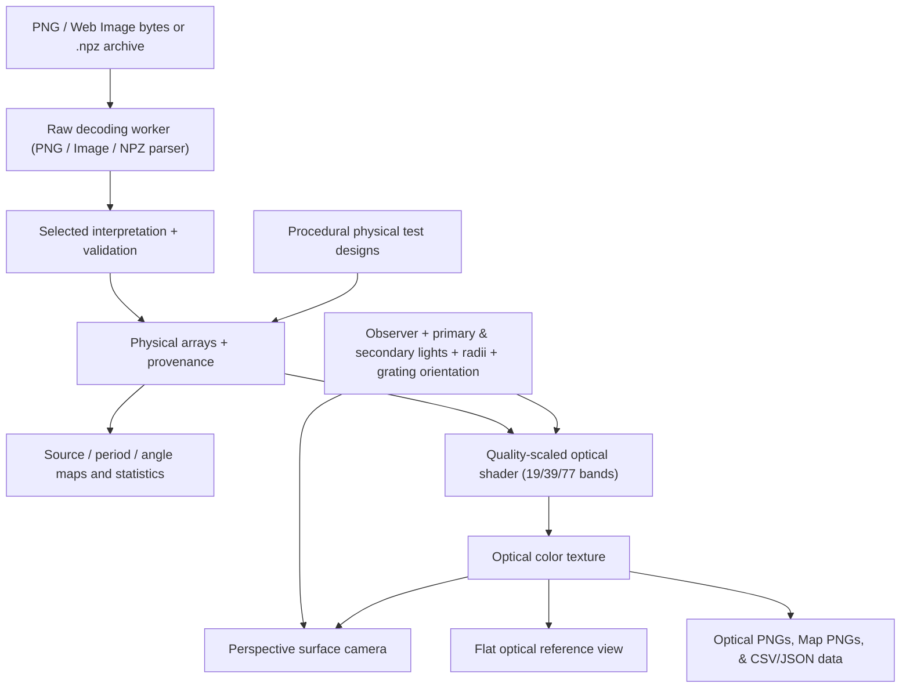

# Dot EBL Web Preview Platform — Implementation Plan

Reviewed 2026-11-01 against commit `5f92be737511c58fa68df672fca1899e674fb60a` and local Python sources. This document specifies future work; the web application and its checks do not exist yet.

## Goal and agreed scope

Build a client-side application for design-image and `.npz` upload, physical parameter inspection, and qualitative optical diffraction preview, deployable as static files on GitHub Pages. Uploaded designs stay in the browser; Python is a development/reference dependency, not a deployed backend.

User decisions from the design review and `/grill-me` alignment:

- Layout: **Dual-Viewport Hero** on desktop: the left side houses the 3D perspective surface view and flat optical reference view; the right side houses the tabbed 2D inspector (Grating Period Map, Rotation Angle Map, Source Image, and Parameter Analytics). Collapses to accessible tabs on mobile.
- Landing State: **Welcome Screen** on initial visit featuring a prominent drag-and-drop upload zone and one-click sample preset cards (concentric grating test pattern, orthogonal cross, spectral fan sweep, and EBL glyph), transitioning smoothly to the Dual-Viewport workbench upon loading.
- Input File Ingestion:
  - **PNG first** for exact numeric parameter profiles (`rgb8-indexed-v1` and `rgb16-fixed-v1`).
  - **Standard web image formats** (PNG, BMP, JPEG, WebP) for legacy appearance interpretations (Holtida HLS, Learning Shaders HLS, Unity HSV).
  - **Client-side `.npz` archive parsing** (`period_nm`, `angle_deg`, `active` arrays) to directly import designs exported by the Python CLI/GUI.
- Optical Rendering & Quality:
  - Shader evaluates propagating diffraction orders $m = \pm 1$, Gaussian beam/aperture convolution, CIE 1931 $2^\circ$ color matching, D65 illuminant, bulk nickel reflectance, and guarded sRGB gamut mapping.
  - **Explicit Quality Toggle**: user-selectable between **High** (77 spectral bands / 5 nm steps), **Balanced** (39 bands / 10 nm steps), and **Performance** (19 bands / 20 nm steps), with adaptive 0.5× resolution downsampling during active orbit drags.
- Illumination Controls: **Single primary light source** by default with directional/Cartesian controls and quick presets (Overhead, 45° Oblique, Grazing), plus an **optional secondary fill light toggle** within an extensible multi-light shader model.
- Export Capabilities:
  - Full-resolution design optical snapshot PNG and perspective capture PNG.
  - Decoded parameter map PNGs (Period Map and Rotation Angle Map).
  - Parameter distribution summary data in CSV and JSON formats.
- Retain the original preview-only scope: **no fabrication UI, GDSII generation, Raith single-pixel path geometry, dose controls, or fabrication bundles**.

Use the adjacent `metasurface-webpage` project as a visual reference for a dark scientific workbench. Its location is a development-machine convenience, not a runtime dependency or a portable repository link.

## Review corrections

| Issue in the previous plan | Corrected requirement |
| --- | --- |
| Root Vite build would use `dist/`, which already contains the desktop executable | Set a separate `web-dist/` output; Vite may empty its output directory during a build. |
| HLS described only broad period/angle ranges | Preserve doubled OpenCV hue indices, 10 nm period quantization, integer angle rounding, corrected lightness masking, and the default hue-162 radial override. |
| Unity decoder omitted activity and angle rules | Preserve saturation threshold, nearest calibrated hue, high-hue override, tie handling, and saturation-to-angle mapping. |
| RGB16 activity allowed `65535 / 255` | Only `65535` is active and `0` inactive; `255` is an invalid reserved code. |
| Uploads assumed browser display decoding preserves parameters | Decode PNG channel samples directly, preserving bit depth and bypassing color transforms and alpha premultiplication. |
| Gamut mapping used fixed D65 white `(0.3127, 0.3290)` | Derive white point and luminance normalization from the nickel-weighted spectrum, matching the renderer. |
| Aperture control specified a diameter without conversion | Existing optical parameters are **radii in mm**. Label them as radii. |
| A full-screen shader was called a 3D view | Add perspective surface rendering tied to the physical observer, and retain the flat reference view. |
| “Exact physical model” and universal 60 FPS were promised | Match the existing approximation within tested numeric tolerances; measure performance on stated devices. |
| A Fresnel zone plate was claimed to produce a particular optical result | Use a concentric grating test pattern; this renderer does not simulate coherent interference/focusing across cells. |
| Pages workflow listed build/deploy actions only | Add reproducible dependencies, verification gates, permissions, environment, build dependency, and Pages configuration. |

## Authoritative local references

Use executable source and tests as the behavior contract; historical audits contain findings that may already have been fixed.

| Concern | Sources |
| --- | --- |
| Physical arrays and coordinates | [`core/model.py`](../src/dot_ebl_preview/core/model.py), [`core/grid.py`](../src/dot_ebl_preview/core/grid.py) |
| RGB profile contracts | [`core/encoding.py`](../src/dot_ebl_preview/core/encoding.py), [`io/images.py`](../src/dot_ebl_preview/io/images.py), [`test_encoding.py`](../tests/test_encoding.py) |
| NPZ archive structure | [`io/artifacts.py`](../src/dot_ebl_preview/io/artifacts.py), [`test_artifacts.py`](../tests/test_artifacts.py) |
| HLS import and radial override | [`io/legacy_hls.py`](../src/dot_ebl_preview/io/legacy_hls.py), [`core/operations.py`](../src/dot_ebl_preview/core/operations.py) |
| Unity HSV import | [`io/legacy_unity.py`](../src/dot_ebl_preview/io/legacy_unity.py), [`test_legacy_import.py`](../tests/test_legacy_import.py) |
| Scene coordinates and GUI decoding | [`gui_logic.py`](../src/dot_ebl_preview/gui_logic.py), [`test_gui_logic.py`](../tests/test_gui_logic.py) |
| GPU parity target | [`preview/gl_renderer.py`](../src/dot_ebl_preview/preview/gl_renderer.py), [`test_gl_preview.py`](../tests/test_gl_preview.py) |
| CPU reference, spectrum, presets | [`optics/engine.py`](../src/dot_ebl_preview/optics/engine.py), [`optics/tables.py`](../src/dot_ebl_preview/optics/tables.py), [`optics/presets.py`](../src/dot_ebl_preview/optics/presets.py) |
| Aperture/source-size behavior | [`test_aperture_and_source_size.py`](../tests/test_aperture_and_source_size.py), [`test_multi_light.py`](../tests/test_multi_light.py) |

## Architecture



Use TypeScript modules and explicit subscriptions; no reactive framework is required. Keep decoded source bytes/samples, physical arrays, scene state, and display state distinct. Publish a design atomically after validation. Decode and compute large statistics in a worker, with request IDs so a slow earlier upload cannot replace a newer selection. Scene changes update uniforms without decoding the source again.

## 1. Repository layout, tooling, and deployment

### Files to add

```text
package.json                 package-lock.json
index.html                   vite.config.ts
tsconfig.json                tsconfig.node.json
vitest.config.ts             playwright.config.ts
web/
  main.ts                    style.css
  lib/io/                    lib/decoders/
  lib/optics/                 lib/store/
  lib/presets/                workers/
  components/welcome/        components/viewer/
  components/controls/       components/export/
tests/web/
  fixtures/                  unit/                  browser/
tools/web/                   # Python fixture generation only
.github/workflows/web-checks.yml
.github/workflows/deploy.yml
```

Keep Python source, packaging, and desktop build paths intact. Place browser assets under a dedicated web asset directory; do not publish `_INPUT/`, `_OUTPUT/`, or desktop binaries.

### Tooling

- Use Vite, TypeScript, Vitest, Playwright, Three.js for the perspective scene, and a PNG decoder exposing original 8/16-bit RGB samples. Verify supported PNG variants, license, browser/worker compatibility, and sample preservation before choosing the decoder.
- Select a mutually compatible, supported package set and Node runtime at implementation time. Record Node version and commit `package-lock.json`; CI uses `npm ci`. The previous mixed-version sample manifest was not a verified dependency set. Include compatible `@types/three` and `@types/node` where required.
- Scripts: `dev`, `preview`, `check`, `build`, `test`, `test:watch`, `test:browser`. `build` runs the complete application/config typecheck before bundling. `test` runs unit tests only.
- Keep Vite's project root at the repository root with `index.html` importing `/web/main.ts`. Set `build.outDir: 'web-dist'`. Only this directory may be emptied by web builds. [Vite build options](https://vite.dev/config/build-options)
- Use `base: './'` for this single-page, tab-based app. Resolve runtime assets through imports, `new URL(..., import.meta.url)`, or `import.meta.env.BASE_URL`; avoid hardcoded root asset URLs and history-based routes. Verify deployment under `/dot-ebl-preview/`. [Vite production build guidance](https://vite.dev/guide/build)
- Configure `@` with `fileURLToPath(new URL('./web', import.meta.url))`; do not assume CommonJS `__dirname` in an ES-module config. Mirror the alias in TypeScript and Vitest. Typecheck Node configs separately from browser/worker code with appropriate libraries.
- Set dev port 3000 with `strictPort: true`. Give Playwright a `webServer`, deterministic base URL, and `testDir: 'tests/web/browser'`. Vitest includes only `tests/web/unit/**/*.test.ts`, avoiding collection of Playwright specs.
- Add `node_modules/`, `web-dist/`, `test-results/`, and `playwright-report/` to `.gitignore`; existing `dist/` is already ignored.

### GitHub Actions and Pages

Run web checks on pull requests and pushes to `main`: dependency install, typecheck, unit tests, build, Playwright browser install, and browser tests. Exercise production output as well as development behavior. A GPU-unavailable test must not silently count as successful optical validation.

Deploy on successful pushes to `main` and manual `workflow_dispatch`, restricted to `main`. Select compatible action releases when implementing the workflow. Configure Pages, upload **only `web-dist/`**, and deploy in a job with `needs` pointing to the verified build job. Give the build `contents: read`; give deployment `pages: write` and `id-token: write`. Set the `github-pages` environment and deployment URL; serialize deployments with a concurrency group. Pull requests run checks without publishing. Repository Settings → Pages must use **GitHub Actions** as the publishing source; adding YAML alone does not enable Pages. [GitHub custom Pages workflows](https://docs.github.com/en/pages/getting-started-with-github-pages/using-custom-workflows-with-github-pages)

## 2. Input and canonical data contracts

### File Ingestion (PNG, Image, and NPZ)

- **PNG files (authoritative for numeric parameter profiles):** Require truecolor RGB PNG: 8-bit for HLS, Unity HSV, and RGB8 indexed; 16-bit for RGB16 fixed. Initially reject palette, grayscale, RGBA, animated PNG, and unsupported interlacing with clear messages. Read bytes into raw `Uint8Array` or `Uint16Array` RGB samples bypassing browser canvas/image color management. Never downconvert RGB16.
- **Other raster formats (BMP, JPEG, WebP):** Supported for legacy appearance interpretations (Holtida HLS, Learning Shaders HLS, Unity HSV). Flag to the user that lossy JPEG compression is inappropriate for exact numeric LUT profiles (`RGB8` and `RGB16`).
- **Python `.npz` design archives (`npzParser.ts`):** Client-side zip/numpy extraction of `design.npz` files exported by the Python codebase. Reads `.npy` array headers and unpacks `period_nm` (uint32), `angle_deg` (float64/float32), and `active` (boolean/uint8) directly into the canonical model, bypassing image interpretation. Validates equal array shapes and safe positive dimensions.
- Validate signatures, dimensions, channels, bit depth, decoded length, and allocation limits before creating arrays/textures. Set documented file-byte and cell limits using measured peak memory and GPU limits. Reject unsupported files gracefully and retain the current valid design.

### Canonical model (`web/lib/decoders/types.ts`)

```typescript
export interface DesignModel {
  width: number;
  height: number;
  pitchNm: number;                 // Positive safe integer nanometres
  periodNm: Uint32Array;           // Row-major, width * height
  angleDeg: Float64Array;          // Preserve Python CPU precision
  active: Uint8Array;              // Exactly 0 or 1
  appearanceRgb?: Float32Array;    // RGB, 3 * width * height, [0, 1]
  fallbackIntensity?: Float32Array;// Scalar per cell, [0, 1]
  sourceIdentity: string;
}
```

Keep raw samples and decoder options in separate source state for reinterpretation. Convert to Float32 at the GPU upload boundary and document that precision limit. Reject non-finite angles and non-positive active periods. Both numeric profile decoders zero inactive periods/angles. Source display and inactive optical fallback have separate meanings.

Pitch is lattice spacing, not grating period. Default standalone importer pitches are 20 µm for Holtida and numeric RGB profiles, 60 µm for Learning Shaders and Unity. Keep an explicit user override; switching interpretation must not silently reset it. Specify integer-nanometre rounding and test it against the chosen Python loading path.

### HLS decoders (`hls.ts`)

Implement the **corrected** mode used by `load_gui_design`; historical `legacy-exact` mode is deferred.

1. Convert RGB8 to quantized OpenCV-style HLS. Preserve hue wrap at 180 and the selected Python path's rounding. Python uses OpenCV when installed and a NumPy fallback otherwise; do not assume bit-identical rounding boundaries. This review environment has no OpenCV, so baseline fixtures must identify the NumPy path and record Python/NumPy versions. Identify additional OpenCV fixtures separately if generated.
2. Use `hueIndex = 2 * H`, not continuous hue. Period is `round(linspace(0.9, 1.2, 360)[hueIndex], 2) * 1000` nm, rounded to integer nm as in Python: a 10 nm lattice, not 360 distinct periods.
3. Angle is `round((S / 255 - 0.5) * rotRange)` degrees, with `rotRange = 180` for Holtida and `90` for Learning Shaders. Match NumPy rounding, including negative values; JavaScript `Math.round` is not a general replacement.
4. Active iff `0 < L < 250`. Zero inactive physical arrays. Preserve normalized appearance and `fallbackIntensity = mean(RGB / 255) / 5`.
5. Apply the default radial override on active cells with `2 * H == 162`, matching `apply_radial_gradient`: center `(floor(W/2), floor(H/2) + 50)` in image-cell coordinates; radius denominator is the center's distance from `(0,0)`, with the same zero guard. Override angle with `base + distance / maxDistance * span`: Holtida `base=-15`, `span=40`; Learning Shaders `base=-5`, `span=25`. This is not a clamp to those nominal endpoints. Preserve floating-point radial angles.

### Unity decoder (`unity.ts`)

Port `shader_rgb_to_hsv` including branch ties and epsilon. Saturation below `0.1` is inactive. For active cells, `h > 0.7` selects 1328 nm; otherwise choose the closest calibrated hue in `[6,25,39,58,90,125,159,205] / 360`, using absolute hue difference and the first entry on an exact tie. Corresponding periods are `[1328,1263,1225,1175,1128,1066,1016,903]` nm.

Angle is `s * (maxAngle - minAngle) + minAngle`, default `[-10°, +10°]`, without integer-degree rounding. Preserve appearance and the HLS-style grayscale fallback. Inactive physical arrays are zero. The eight periods are not equal-width hue bins.

### Numeric profiles (`rgbIndexed.ts`)

- **RGB8 indexed:** Require RGB8. Validate B for every pixel: only `0` or `255`. Active pixels require `R <= 30`, `G <= 180`; decode `periodNm = 900 + 10 * R`, `angleDeg = G - 90`. Ignore inactive R/G codes, matching Python. Use default LUTs only; custom profile sidecars are deferred.
- **RGB16 fixed:** Require RGB16. Validate B for every pixel: only `0` or `65535`. Active R is period nm within `[100,65535]`; angle is `(Number(G) - 32768) / 100`, giving `[-327.68°, +327.67°]`. Subtract in signed/number arithmetic to avoid unsigned underflow. Ignore inactive R/G codes.
- Numeric importers do not derive optical fallback from the visible code image. Inactive cells are black without an explicit physical fallback. The source pane may show a labeled RGB16 display conversion; it must never be decoded back into physical parameters.

### Procedural presets (`sampleDesigns.ts`)

Generate physical designs directly: concentric rings with defined directions, orthogonal domains, a period/angle sweep, and an emblem with known tiles. Include asymmetry to expose row flips and angle-sign mistakes. Presets bypass image decoders; an arbitrary physical design cannot round-trip through every interpretation. Disable interpretation selection for physical presets or require an uploaded source first.

Call the rings a **concentric grating test pattern**, not a focusing Fresnel zone plate. This model sums per-cell spectral intensity without cross-cell phase propagation. Do not promise bright rainbows for every scene; verify useful default scenes.

## 3. Optical model and WebGL port

### Tables and normalization (`tables.ts`)

Generate/check in the 77-band tables from Python with provenance. Wavelengths are 380–760 nm inclusive at 5 nm intervals. Python `s2xyz()` is `(3,77)`; `premultiplied_XYZ()` is `(77,3)` and includes D65 and nickel reflectance. Generate downsampled subsets for the quality toggle: 39 bands (10 nm intervals) and 19 bands (20 nm intervals).

Match shader normalization for each quality level: `lightXYZ = sum(premultipliedXYZ)`, `lightY = lightXYZ[1]`, `whiteXY = lightXYZ.xy / sum(lightXYZ)`. Derived values are computed from tables at initialization. Port the existing XYZ-to-linear-sRGB row-dot-product matrix and guarded gamut mapping.

### Physical coordinates and controls (`coordinates.ts`)

- World units are mm: `pitchMm = pitchNm * 1e-6`. Cell `(row,col)` center is `((col+0.5-W/2)*pitchMm, -(row+0.5-H/2)*pitchMm, 0)`. Rows run downward; world +Y runs upward, +Z faces the observer.
- At 0°, grating lines run along +X; reciprocal direction is `(-sin(theta), cos(theta))`. Global **grating orientation** adds to cell angles for optics only. It does not rotate positions or rewrite parameter maps. Future rigid sample rotation would also require rotating positions/normals.
- Preserve `position_from_direction`: azimuth from +X toward +Y, elevation from XY toward +Z; `(x,y,z) = d * (cos(el)*cos(az), cos(el)*sin(az), sin(el))`. Reject zero distance/non-finite values; test wrap and pole ambiguity.
- Start with optical defaults: camera `(0,0,300)` mm; light `(0,400*sin(35°),400*cos(35°))` mm; observer aperture radius `2` mm; source radius `20` mm; relative intensity `1`. Support an optional secondary fill light with independent position/intensity uniforms.

### Shader and model fidelity (`shaders.ts`)

Port the current **corrected OpenGL shader**, orders `m = ±1`. The CPU `unity-hsv` optical preset also has ±2 orders; it is outside initial browser parity. Keep image decoding independent of this choice.

Preserve finite-cell Gaussian diffraction width from pitch, source/detector angular broadening, aperture collection fraction, incident/outgoing cosines, propagating-order checks, spectral sum, gamut mapping, clipping, and piecewise sRGB transfer. Inactive cells output stored grayscale fallback directly; do not gamma-encode that branch again. Active cells without contributing light are black. Do not add an inverse-square multiplier: aperture collection already provides the model's viewing-distance dependence.

Support active light count in uniform loop (`u_num_lights = 1` or `2`). Adapt desktop GLSL 330 to GLSL ES `#version 300 es` with explicit high precision and supported interfaces. Replace desktop `sampler1D` with a `sampler2D` using integer-coordinate fetches (`texelFetch`). Use a full-screen triangle for optical evaluation. WebGL2 follows OpenGL ES rather than desktop OpenGL. [WebGL2 specification](https://registry.khronos.org/webgl/specs/2.0.0/)

Pack `(period,angle,active,fallback)` in an `RGBA32F` parameter texture with nearest sampling, clamp-to-edge, and no mipmaps. The spectrum uses padded RGBA floats. These are data textures: no sRGB transforms or parameter interpolation. Use an `RGBA8` optical target; sampling float inputs does not itself require a float color-buffer extension. Check allocation/framebuffer errors. [Texture formats and renderability](https://developer.mozilla.org/en-US/docs/Web/API/WebGLRenderingContext/texImage2D)

This is a qualitative geometric/Gaussian approximation with uncalibrated efficiency. It does not model groove depth/profile, polarization, coherent focusing, or measured brightness. Parity means agreement with reviewed source within explicit float32/8-bit tolerances, not exact electromagnetic prediction.

## 4. Perspective surface and flat reference views

Use a shared Three.js/WebGL2 context and managed targets to keep optical textures on the GPU. Avoid separate raw-WebGL and Three.js contexts requiring CPU transfer between them. Implement the spectral pass as a custom shader material, separate from perspective presentation.

- Render a plane at `z=0`, sized `W*pitchMm` by `H*pitchMm`, with optical texture orientation matching the maps. Perspective adds foreshortening; no grating-chord or fabrication geometry is needed.
- Perspective camera position is the physical observer position, looking toward the design center. Orbit/dolly updates that position and shader uniforms together. Implement the repository's Z-normal coordinates explicitly rather than substituting library spherical conventions. Handle top-down basis/poles without roll jumps or singularities.
- **Fit view** adjusts projection/framing without changing physical observer distance; wheel distance changes are physical. Keep projection aspect/near/far valid on resize. Define top-down screen orientation as +X right and +Y up. Surface ray picking reports the corresponding design cell.
- Display optical colors through an unlit custom presentation pass. Avoid material lighting, tone mapping, or duplicate sRGB transfer. Define and test target color-space handling for the pinned Three.js version; its input/working/output conversions need explicit treatment. [Three.js color-management guidance](https://discourse.threejs.org/t/updates-to-color-management-in-three-js-r152/50791)
- Retain an aspect-correct flat optical view of the same physical scene. This is compared with Python and exported at design resolution; perspective screenshots are separate, labeled viewport captures.
- Full-quality optics evaluates cell centers, one color per design cell. Reduced interaction targets may sample fewer cells using their original world positions; label that approximation. Settled rendering restores full cell resolution within the supported limit. Filter rendered colors for minification if needed; never average period/angle data.

### Lifecycle and performance

Use dirty-driven `requestAnimationFrame`, coalesce rapid inputs, and avoid idle spectral work. Provide an explicit **Quality Toggle** (High: 77 bands, Balanced: 39 bands, Performance: 19 bands) plus automatic 0.5× optical target downsampling during mouse/touch interaction. Restore full optical texture quality after settling and for optical export. Use design/scene revisions so stale worker results or captures cannot appear current.

Benchmark 256², 1075², and 2048² designs, recording target size, active fraction, device/browser, median/p95 frame time, input latency, and peak memory. Use results to set file/cell limits.

Check WebGL2 availability, texture/renderbuffer/viewport limits, and allocations. Keep maps/source/statistics usable without optics. Handle context loss/restoration and dispose replaced resources. Large-image tiling and CPU/WASM optics are deferred; report supported limits.

## 5. Workbench UI and inspection

Build the dark responsive workbench in `index.html`, `web/style.css`, and TypeScript components. Desktop shows the Dual-Viewport Hero: perspective/flat optics on the left, tabbed 2D inspection on the right. Mobile uses accessible tabs.

- **WelcomeView:** clean initial landing container featuring a prominent drag-and-drop file target (supporting images and `.npz`) and 4 one-click sample preset cards (concentric test pattern, orthogonal cross, spectral fan, EBL glyph), animating into the workbench upon selection.
- **DesignControls:** file input/drop zone, five interpretations + NPZ detection, presets, pitch with units, global grating orientation, and the explicit Quality Toggle (High, Balanced, Performance). Errors identify rules and offending values/coordinates where practical. Interpretation changes may validly fail; never silently coerce numeric codes or overwrite the last valid model.
- **SceneControls:**
  - Primary light: spherical/Cartesian coordinates, source radius, intensity, reset/top/oblique/grazing presets.
  - Secondary fill light: toggle to activate, with independent position/intensity controls.
  - Observer camera: position, aperture radius, reset/top/oblique view presets.
  - Orbit stays on the reflective front side; explicitly entered rear-side positions give the reference model's dark result. Avoid exact side-on defaults that degenerate the plane.
- **Interaction:** left drag orbits observer; right drag orbits light; wheel changes observer distance; Shift+wheel changes light distance. Prevent the canvas context menu, use pointer capture, and provide an observer/light toggle for touch plus keyboard/numeric alternatives. Restrict wheel capture to the viewer.
- **ParameterMapCanvas:** aspect-correct nearest-cell maps, inactive color, readable units/legends, probes showing `(row,col)`, physical coordinates, period, stored angle, activity. Account for CSS scaling, pixel ratio, and letterboxing. Show effective optical angle separately when global orientation is nonzero. Include a button to download the rendered parameter map as a PNG image.
- **Angles:** use a labeled 180° axial hue wheel while preserving full signed source angles in data/probes/statistics. The symmetric ±1 optical response is axial, but source values must not be normalized or merged. This is a web visualization choice; the current desktop uses a min/max color ramp.
- **Source pane:** original RGB8 samples, labeled RGB16 display conversion, or “procedural / NPZ design — no original RGB image.”
- **StatsPanel & ExportControls:**
  - Active count; fill factor with all cells as denominator; physical extent `(W*pitchNm/1e6) × (H*pitchNm/1e6)` mm; active-only histograms and distinct counts.
  - Export menu providing:
    1. Full-resolution flat optical preview PNG.
    2. Perspective viewport capture PNG.
    3. Decoded Period Map PNG and Rotation Angle Map PNG.
    4. Active parameter distribution data in CSV and JSON formats.
- Use semantic labels, visible focus, keyboard tabs, numeric slider alternatives, and sufficient contrast. Keep implementation details out of ordinary product flows.

## 6. Implementation sequence and verification gates

### A. Reference fixtures before visual polish

Add `tools/web/` generators using unmodified Python to write small raw PNG inputs, `.npz` test archives, expected arrays, scenes, optical reference images, and spectral data into `tests/web/fixtures/`. Record source commit, generator command, dependencies, HLS path, units, and tolerances. Commit self-contained synthetic fixtures; large `_INPUT/` assets are optional manual benchmarks, not CI dependencies.

Cover HLS primary/achromatic colors, hue wrap/rounding, L around 0/250, hue-162 overrides on odd/even rectangular grids; Unity thresholds/ties/high-hue/angles/fallback; RGB8 boundaries/reserved codes; RGB16 samples differing only in low bytes; `.npz` valid archives and malformed arrays. Validate sample preservation even with color metadata.

### B. Pure functions and input tests (Vitest)

- Compare arrays to Python: periods/activity exact, integer HLS angles exact, tight documented tolerances for radial/Unity float64 angles. Compare `.npz` parser output with Python `load_design_artifact`.
- Compare all spectral values, not just shape/nonzero or a “D65 peak.” Test `(3,77)` to `(77,3)` orientation, normalization, derived white, matrix direction, gamut guards, and sRGB boundaries across all three quality levels (19, 39, 77 bands).
- Test coordinates by Cartesian equivalence at wraps/poles; azimuth is undefined at poles. Verify rectangular grids, row direction, pitch scaling, and global orientation independently.
- Test invalid inputs, worker races, inactive/constant statistics, and failed decoding retaining the previous design.

### C. Browser optics and interaction (Playwright)

- Prove shader compilation/drawing and compare **flat design-resolution readback** with Python CPU/desktop fixtures; a canvas element existing is insufficient. Start with the desktop test's maximum error budget of 4 code values per 8-bit channel, including its nonzero-light test. Assess edge cases separately; this bound is not yet established across browsers.
- Cover non-square asymmetric designs, signed/global angles, camera/light distance, aperture/source radii, inactive fallback (e.g. `0.2 → 51`), all-inactive input, zero intensity/aperture, rear-side geometry, and secondary fill light activation. Check GL errors/non-finite outputs.
- Test perspective foreshortening, top-down basis, picking, synchronized observer controls, and color agreement with the flat texture at known cells. Distinguish projection/framing from physical movement.
- Test uploads of all five interpretations and `.npz` archives, rejection, source switching, probes/legends, statistics, keyboard/touch, desktop and 390×844 layouts, resizing, context recovery.
- Test export actions: optical PNG dimensions/orientation, perspective capture, parameter map PNGs, and CSV/JSON data format.
- Serve the production bundle from `web-dist/` at a nested path equivalent to `/dot-ebl-preview/`; check scripts, workers, textures, styles for loading failures. Use Chromium for CI optics and smoke-test Firefox/WebKit, recording browser/GPU limits.

### D. Isolation, regression, and release checks

Once implemented, from the repository root:

```powershell
npm ci
npm run check
npm test
npm run build
npx playwright install --with-deps
npm run test:browser
.\.venv\Scripts\python.exe -m pytest tests/
```

The Python command assumes the project/test dependencies are installed in `.venv`; use platform-appropriate Python in CI. Report skips (especially GUI/GPU) and failures rather than saying the suite guarantees no regressions.

Verify `web-dist/index.html`, nested-path loading, and that web builds leave desktop `dist/` untouched. Smoke-test desktop launch if integration files change. Document measured performance, limits, supported formats, and optical approximations before release.

## Deferred work

Deferred for future releases:
- Fabrication UI, GDSII stream release 3 layout generation, Raith single-pixel exposure line chords, dose multipliers, and fabrication bundle staging (`angles.txt`, `gratings.txt`, GDS files).
- Interactive parameter editing and spatial filtering (Gaussian/bilateral smoothing, resample).
- ±2 diffraction orders and calibrated electromagnetic/RCWA modeling.
- Large-design out-of-core tiling and CPU/WASM fallback renderer.
